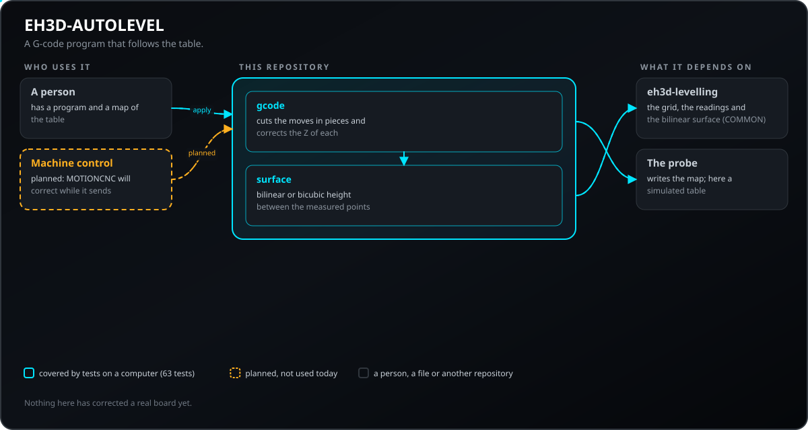
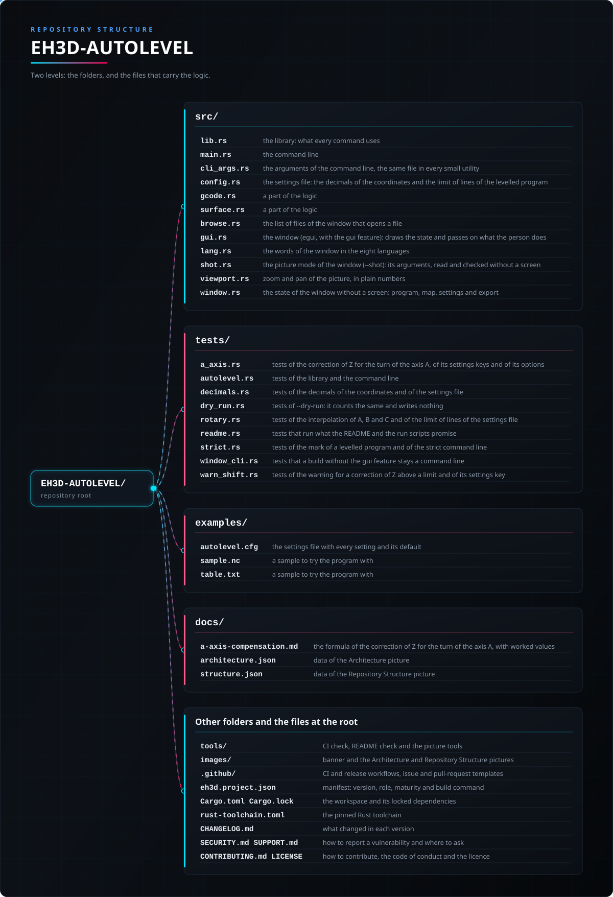

<p align="center">
  
</p>

#  EH3D-AUTOLEVEL
<p align="center">🇺🇸 <b>English</b> | <a href="README_spa.md">🇪🇸 Español</a> | <a href="README_fra.md">🇫🇷 Français</a> | <a href="README_ita.md">🇮🇹 Italiano</a> | <a href="README_deu.md">🇩🇪 Deutsch</a> | <a href="README_zho.md">🇨🇳 中文</a> | <a href="README_jpn.md">🇯🇵 日本語</a> | <a href="README_por.md">🇵🇹 Português</a></p>

### Corrects the Z of a G-code program with the height map of the table

<p align="center">
  
  
  
  
  
</p>

---

**Honesty check - what actually runs today:** a Rust library and a command line program (`eh3d-autolevel`) with 128 tests that run on a computer: corrects the Z of a G-code program with the height map of the table, cutting the moves in pieces that follow the surface. It has a window (built with `--features gui`) that opens a G-code program and a height map, shows the table as a coloured mesh with the levelled paths over it and exports, but the window has not been looked at on a screen yet; it has not been tried on a machine and it has not been checked against a collection of real files.

---

> **Safety and security status:** this program does not control any machine and is not a safety system. What it produces must be checked by a person before anything is run on a machine; nothing here has run on real hardware.


## 📋 At a glance

| | |
|---|---|
| Version | `0.0.5` |
| Maturity | Scaffolding |
| Tests | 128 |
| Stack | Rust |
| On real hardware | Not tried: nothing here has run on a machine |

**Jump to:** [Overview](#-overview) · [Architecture](#-architecture) · [Quick start](#-quick-start) · [Testing](#-testing) · [Structure](#-repository-structure) · [Related](#-related-projects)

## 🚦 Project status

Each line is one part of this repository and the light says how far it is today. It is written from what the repository can show (tests, builds, runs), not from what is planned.

🟢 Done and verified · 🟡 Works, with known limits · 🟠 Partly done or not verified yet · 🔴 Not done or not working

| Area | State | What it means here |
|---|---|---|
| Core | 🟡 | corrects the Z of a G-code program with the height map of the table, cutting the moves in pieces that follow the surface; tested on a computer with normal and damaged input, not with a collection of real files. |
| Command line | 🟡 | `eh3d-autolevel` runs the same functions as the library and prints the result; every error comes back as a message and a non-zero exit code. |
| Tests | 🟡 | 128 tests pass (`cargo test`), with normal cases, edge cases and damaged input. |
| Security | 🟡 | Plain safe Rust (`forbid(unsafe_code)`): nothing panics on the files it is given and a bad value is an error with its reason; no independent review. |
| Window | 🟠 | Written (egui, `--features gui`): open or drop a program and a height map, simulate a table, see the table as a coloured mesh and the levelled paths, zoom and pan, set the levelling, export; its logic is tested, but it has not been built or looked at on a screen yet. |
| Real hardware | 🔴 | Not tried: nothing here has been run on a machine. |
| Documentation | 🟡 | README in eight languages, the changelog and the two pictures drawn from `docs/`. |

## 🎯 Overview

* **The program** (`src/gcode.rs`): a cutting move (G1) is cut in pieces no longer than the chosen length and each piece gets the Z that the map gives for its end; a rapid move (G0) is corrected only when it has a Z word. The zero of the correction is a reference point, the one where the Z of the job was set.
* **The surface** (`src/surface.rs`): bilinear (the one of the map in EH3D-COMMON) or bicubic (Catmull-Rom), which goes through every measured point and follows a curved table better; outside the grid the height of the nearest edge is used.
* **What is refused** with the number of the line: relative distances (G91), inches (G20), arcs (G2, G3), a move before any G0 or G1, a number that is not a number, a coordinate beyond a million millimetres, a move that would make more than a hundred thousand pieces and a map with points that were not measured.
* **Strict command line:** an option that is written wrong (`--powr`) or a word too many is an error that names it, not something to ignore; the program would otherwise make its output with the default values.
* **Never levelled twice:** the corrected program starts with a comment line (`(eh3d-autolevel VERSION map=HASH ref=X,Y method seg=N)`) that says it was levelled and with which map; a program that carries it is refused with its line, because correcting it again would add the correction of the table twice.
* **Codes that move the origin are refused:** G10, G28, G30, G38, G43, G53, G92 and any other G code that is not a plain move or a setting that leaves the position alone stop the program with the number of the line (they used to be turned into moves to Z0); a dwell (G4) and the `%` line of the start and the end of a program pass through, and a map that gives no finite height is refused instead of writing `Z NaN`.
* **`--dry-run`:** `apply` works the result out and counts it (moves, pieces added, shift of Z) without writing the output file, which may then be left out.

## 🧩 Role in EH3D

EH3D-AUTOLEVEL is one program of the EH3D Fabrication Suite. It works as a library and a command line and, built with `--features gui`, as a window in the look the other programs of the suite share. It reads and writes plain files, so it can be used on its own or between the other programs.

## 🏛️ Architecture

<p align="center">
  
</p>


How the parts of this repository fit together: who uses it, what it holds and what it depends on. The picture is drawn from `docs/architecture.json` and checked against the code.

## ✨ Features

* **A library and a command line:** every command of `eh3d-autolevel` is a function of the library, so another program of the suite can call it without starting a process.
* **Tests with damaged input:** the tests also feed empty files, garbage, huge numbers and cut files, and none of them may panic.
* **No guessing:** a value that does not make sense is an error that says which value and why, never a result that only looks right.
* **No unsafe code:** `#![forbid(unsafe_code)]` in the library and the program.
* **Lines that are not moves pass through:** `$` commands, `#` assignments and the messages `M117` and `M118` are written as they are, the checksum of a numbered line is not a word, the `M` words of a cut move go with its last piece, and `--max-lines` (5000000 by default) refuses a program that would have more output lines.
* **The levelled program starts with the standard header:** the generator and its version, the units, the program it came from with its SHA-256 and the tools, as comment lines before the mark; the tests read the result back with the reader of the suite and find no warning, no rapid move into the material and no cut with the spindle off.

## 🔒 Security & Safety

| Threat | Defense |
|---|---|
| A damaged, truncated or empty file | no panic: the tests cut valid input at every position and feed garbage |
| A number that makes no sense (negative, not finite, absurdly large) | refused with an error that names the value; nothing is rounded into something plausible |
| Unsafe memory use | plain safe Rust with `forbid(unsafe_code)` |

**What is not defended:** a result that was produced cleanly is not a verified result. Nothing here knows the limits of a machine, and the program has had no independent review. Report a vulnerability privately (see [SECURITY.md](SECURITY.md)).

## 🔌 Interfaces

The library is `eh3d_autolevel` (`use eh3d_autolevel::...`); the command line is `eh3d-autolevel`. The commands are these; each prints its result on the standard output and reports an error on the standard error with a non-zero exit code. There is no network access.

```text
eh3d-autolevel apply MAP.txt IN.nc OUT.nc [--segment 1.0] [--ref X,Y] [--bicubic] [--max-lines 5000000] [--dry-run]
eh3d-autolevel info MAP.txt                      how many points, the spread and the tilt of the table
eh3d-autolevel demo-map OUT.txt X0 Y0 X1 Y1 COLS ROWS    a map of a simulated tilted table with a bump
eh3d-autolevel [gui] [FILE...]                   the window (a build with --features gui); with no arguments it opens
```

## ⚙️ Configuration

There is no configuration file yet: what a person chooses is given as arguments of the command line (see Interfaces) and every default is written in the help of the command (`eh3d-autolevel help`). The fixed limits live in the code as named constants and are covered by tests.

## 🚀 Quick start

You need a stable Rust toolchain (1.88 or newer).

```bash
cargo build --release
cargo test
cargo run --release -- info examples/table.txt
cargo run --release --features gui   # the window
```

## 🧪 Testing

The suite has 128 tests (`cargo test`, run on Windows and Linux in the CI). They check the normal cases, the edge cases and damaged input: empty files, garbage and cut files never panic. The CI also runs `cargo fmt --check`, `cargo clippy` with warnings as errors and `python -I tools/ci_validate.py`.

## 🏗️ Build & Release

The version lives in `Cargo.toml` and in `eh3d.project.json`; each version has its entry in [CHANGELOG.md](CHANGELOG.md). `build.bat` / `build.sh` build the program, `test.bat` / `test.sh` run the tests and `run.bat` / `run.sh` run it with a sample. Releases are published on GitHub.

### Downloads

Each release has the program with its window for Windows (64 and 32 bits), Linux (64 bits) and macOS (Apple silicon and Intel), as `<name>-<version>-<system>.zip` (Windows) or `.tar.gz` with the program, the licence, the readme, the icon and the examples. The files are built by GitHub Actions, listed in `SHA256SUMS` and signed with the EH3D key. To check a download, compare its hash with the `.sha256` file next to it (`sha256sum -c`) and check its signature with the `.sig` file next to it (`ssh-keygen -Y verify`).

## 📂 Repository Structure

<p align="center">
  
</p>

<details>
<summary>Text version of the tree</summary>

```text
EH3D-AUTOLEVEL/
├── src/
│   ├── lib.rs                                   the library: what every command uses
│   ├── main.rs                                  the command line
│   ├── cli_args.rs                              the arguments of the command line, the same file in every small utility
│   ├── gcode.rs                                 a part of the logic
│   ├── surface.rs                               a part of the logic
│   ├── browse.rs                                the list of files of the window that opens a file
│   ├── gui.rs                                   the window (egui, with the gui feature): draws the state and passes on what the person does
│   ├── lang.rs                                  the words of the window in the eight languages
│   ├── viewport.rs                              zoom and pan of the picture, in plain numbers
│   └── window.rs                                the state of the window without a screen: program, map, settings and export
├── tests/
│   ├── autolevel.rs                             tests of the library and the command line
│   ├── dry_run.rs                               tests of --dry-run: it counts the same and writes nothing
│   ├── readme.rs                                tests that run what the README and the run scripts promise
│   ├── strict.rs                                tests of the mark of a levelled program and of the strict command line
│   └── window_cli.rs                            tests that a build without the gui feature stays a command line
├── examples/
│   ├── sample.nc                                a sample to try the program with
│   └── table.txt                                a sample to try the program with
├── docs/
│   ├── architecture.json                        data of the Architecture picture
│   └── structure.json                           data of the Repository Structure picture
├── tools/                                       CI check, README check and the picture tools
├── images/                                      banner and the Architecture and Repository Structure pictures
├── .github/                                     CI and release workflows, issue and pull-request templates
├── eh3d.project.json                            manifest: version, role, maturity and build command
├── Cargo.toml Cargo.lock                        the workspace and its locked dependencies
├── rust-toolchain.toml                          the pinned Rust toolchain
├── CHANGELOG.md                                 what changed in each version
├── SECURITY.md SUPPORT.md                       how to report a vulnerability and where to ask
└── CONTRIBUTING.md CODE_OF_CONDUCT.md LICENSE   how to contribute, the code of conduct and the licence
```

</details>

## 🗺️ Roadmap & Known limits

**Known limits today**

* The window has not been looked at on a screen yet and cannot measure a table: the map is opened from a file or simulated.
* It has not been tried on a machine nor with a collection of real files, and it has had no independent review.
* Arcs are refused instead of being cut in pieces, the program is assumed to start at X0 Y0 Z0, and the map comes from the probe of the suite or from a simulated table, not from a real measure.

**Next**

* Cut arcs into pieces, take the start position from the machine and correct the program while it is sent, not before.
* Look at the window on a screen and finish it.
* Try it with real files and with the other programs of the suite.

## 🌍 Languages

README and texts exist in English, Spanish, French, Italian, German, Chinese, Japanese and European Portuguese.

## 🔗 Related Projects

* [EH3D-COMMON](https://github.com/JuanenRac/EH3D-COMMON): the project container and the shared types of the suite
* [EH3D-PHOENIX-CNC](https://github.com/JuanenRac/EH3D-PHOENIX-CNC): the machine control program
* [EH3D-ISOCAM](https://github.com/JuanenRac/EH3D-ISOCAM): isolation milling of copper
* [EH3D-ROUTEPRO](https://github.com/JuanenRac/EH3D-ROUTEPRO): the contour milling program
* [EH3D-CAM-DEBUGGER](https://github.com/JuanenRac/EH3D-CAM-DEBUGGER): the checking of G-code before it reaches a machine

## 📚 Documentation

* [Changelog](CHANGELOG.md)
* [Architecture and structure data](docs/architecture.json): the data the two pictures are drawn from.

## 🤝 Contributing & Community

* Before a pull request run `cargo fmt --check`, `cargo clippy --all-targets -- -D warnings`, `cargo test` and `python -I tools/ci_validate.py`: all must pass. See [CONTRIBUTING.md](CONTRIBUTING.md) and the [code of conduct](CODE_OF_CONDUCT.md).
* The README exists in eight languages: a change to the text is made in all eight files, and the two pictures are drawn from `docs/architecture.json` and `docs/structure.json` by `tools/make_architecture.py` and `tools/make_structure.py`.
* Report a vulnerability privately: [SECURITY.md](SECURITY.md). Questions, ideas and reports: electrohobby3d@gmail.com ([SUPPORT.md](SUPPORT.md)).

## 👤 AUTHOR

**JuanenRac (Electro Hobby 3D)** · electrohobby3d@gmail.com

## 📜 LICENSE

Software: GPL-3.0-or-later. See [LICENSE](LICENSE). Hardware designs of the suite use CERN OHL-S.
