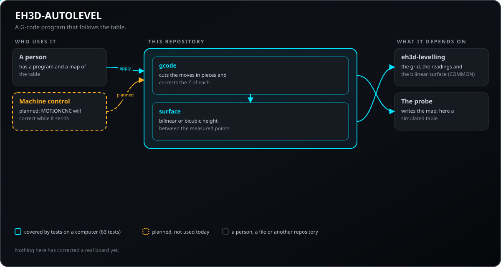
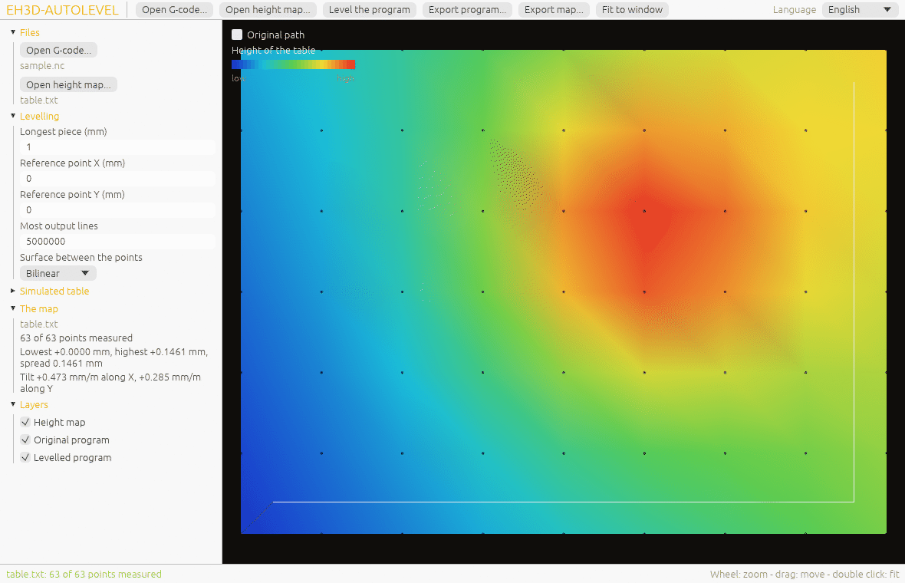
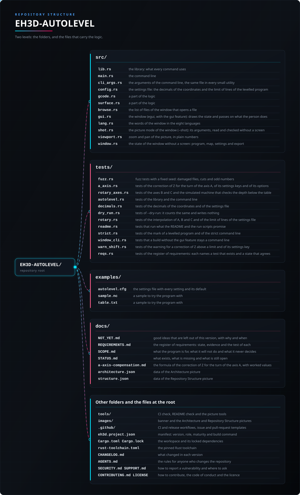

<p align="center">
  
</p>

#  EH3D-AUTOLEVEL
<p align="center">🇺🇸 <b>English</b> | <a href="README_spa.md">🇪🇸 Español</a> | <a href="README_fra.md">🇫🇷 Français</a> | <a href="README_ita.md">🇮🇹 Italiano</a> | <a href="README_deu.md">🇩🇪 Deutsch</a> | <a href="README_zho.md">🇨🇳 中文</a> | <a href="README_jpn.md">🇯🇵 日本語</a> | <a href="README_por.md">🇵🇹 Português</a></p>

### Corrects the Z of a G-code program with the height map of the table

<p align="center">
  
  
  
  
  
</p>

---

**Honesty check - what actually runs today:** a Rust library and a command line program (`eh3d-autolevel`) with 285 tests that run on a computer: corrects the Z of a G-code program with the height map of the table, cutting the moves in pieces that follow the surface. It has a window (built with `--features gui`) that opens a G-code program and a height map, shows the table as a coloured mesh with the levelled paths over it and exports, but the window has not been looked at on a screen yet; it has not been tried on a machine and it has not been checked against a collection of real files.

---

> **Safety and security status:** this program does not control any machine and is not a safety system. What it produces must be checked by a person before anything is run on a machine; nothing here has run on real hardware.


## 📋 At a glance

| | |
|---|---|
| Version | `0.1.2` |
| Maturity | Functional |
| Tests | 285 |
| Stack | Rust |
| On real hardware | Not tried: nothing here has run on a machine |

**Jump to:** [Overview](#-overview) · [Architecture](#-architecture) · [Quick start](#-quick-start) · [Testing](#-testing) · [Structure](#-repository-structure) · [Related](#-related-projects)

## 🚦 Project status

Each line is one part of this repository and the light says how far it is today. It is written from what the repository can show (tests, builds, runs), not from what is planned.

🟢 Done and verified · 🟡 Works, with known limits · 🟠 Partly done or not verified yet · 🔴 Not done or not working

| Area | State | What it means here |
|---|---|---|
| Core | 🟡 | corrects the Z of a G-code program with the height map of the table, cutting the moves in pieces that follow the surface; tested on a computer with normal and damaged input, not with a collection of real files. |
| Command line | 🟡 | `eh3d-autolevel` runs the same functions as the library and prints the result; every error comes back as a message and a non-zero exit code. |
| Tests | 🟡 | 285 tests pass (`cargo test`), with normal cases, edge cases and damaged input. They include a seeded simulation of a probing session with the faults of the probe node with injected faults and recovery. |
| Security | 🟡 | Plain safe Rust (`forbid(unsafe_code)`): nothing panics on the files it is given and a bad value is an error with its reason; no independent review. |
| Window | 🟠 | Written (egui, `--features gui`): open or drop a program and a height map, simulate a table, see the table as a coloured mesh and the levelled paths, zoom and pan, set the levelling, export; its logic is tested, but it has not been built or looked at on a screen yet. |
| Real hardware | 🔴 | Not tried: nothing here has been run on a machine. |
| Documentation | 🟡 | README in eight languages, the changelog and the two pictures drawn from `docs/`. |

## 🎯 Overview

* **The program** (`src/gcode.rs`): a cutting move (G1) is cut in pieces no longer than the chosen length and each piece gets the Z that the map gives for its end; a rapid move (G0) is corrected only when it has a Z word. The zero of the correction is a reference point, the one where the Z of the job was set.
* **The surface** (`src/surface.rs`): bilinear (the one of the map in EH3D-COMMON) or bicubic (Catmull-Rom), which goes through every measured point and follows a curved table better; outside the grid the height of the nearest edge is used. `correct` counts the points that lie outside the measured area and warns, as it does when the reference point is outside it.
* **What is refused** with the number of the line: relative distances (G91), inches (G20), arcs (G2, G3, unless `arcs = cut`), a move before any G0 or G1, a number that is not a number, a coordinate beyond a million millimetres, a move that would make more than a hundred thousand pieces and a map with points that were not measured.
* **Strict command line:** an option that is written wrong (`--powr`) or a word too many is an error that names it, not something to ignore; the program would otherwise make its output with the default values.
* **Never levelled twice:** the corrected program starts with a comment line (`(eh3d-autolevel VERSION map=HASH ref=X,Y method seg=N)`) that says it was levelled and with which map; a program that carries it is refused with its line, because correcting it again would add the correction of the table twice.
* **Codes that move the origin are refused:** G10, G28, G30, G38, G43, G53, G92 and any other G code that is not a plain move or a setting that leaves the position alone stop the program with the number of the line (they used to be turned into moves to Z0); a dwell (G4) and the `%` line of the start and the end of a program pass through, and a map that gives no finite height is refused instead of writing `Z NaN`.
* **`--dry-run`:** `apply` works the result out and counts it (moves, pieces added, shift of Z) without writing the output file, which may then be left out.

## 🧩 Role in EH3D

EH3D-AUTOLEVEL is one program of the EH3D Fabrication Suite. It works as a library and a command line and, built with `--features gui`, as a window in the look the other programs of the suite share. It reads and writes plain files, so it can be used on its own or between the other programs.

## 🏛️ Architecture

<p align="center">
  
</p>


How the parts of this repository fit together: who uses it, what it holds and what it depends on. The picture is drawn from `docs/architecture.json` and checked against the code.

## 🖼️ Screenshots

<p align="center">
  
</p>

<p align="center"><em>The window with an example program and height map: the table coloured from low to high, the points measured and the path of the program, with the summary of the map on the left.</em></p>

## ✨ Features

* **A library and a command line:** every command of `eh3d-autolevel` is a function of the library, so another program of the suite can call it without starting a process.
* **Tests with damaged input:** the tests also feed empty files, garbage, huge numbers and cut files, and none of them may panic.
* **No guessing:** a value that does not make sense is an error that says which value and why, never a result that only looks right.
* **No unsafe code:** `#![forbid(unsafe_code)]` in the library and the program.
* **Lines that are not moves pass through:** `$` commands, `#` assignments and the messages `M117` and `M118` are written as they are, the checksum of a numbered line is not a word, the spindle and coolant words (`M3` to `M9`) of a cut move go with its first piece and the ending words (`M0`, `M1`, `M2`, `M30`) with its last piece, and `--max-lines` (5000000 by default) refuses a program that would have more output lines.
* **The rotary axes A, B and C are interpolated:** when a cutting move is cut in pieces, its `A`, `B` and `C` words go in a straight line from the value they had to the one the move gives (they are modal and start at 0), with the same decimals as X, Y and Z, and the last piece ends exactly on the target; the Z of the table still comes from X and Y only. A program with no rotary words is written as before.
* **Z compensation for the turn of the axis A:** with `a-axis-compensation = tilt` and `a-axis-radius-mm = r` (or `--a-compensation tilt --a-radius r`), every written move gets `r * (1 - cos A)` added to its Z after the height of the table, with A in degrees as the move leaves it (interpolated piece by piece); it is `off` by default, which changes no output, and a notice on the error output says when it was applied. The formula is in `docs/a-axis-compensation.md`.
* **The axes B and C:** the axis B (a turn about Y) has the same compensation with its own radius (`b-axis-compensation = tilt` and `b-axis-radius-mm` in the file, `--b-compensation` and `--b-radius`) and the two add up; the axis C turns about Z, changes no height and needs none (its words are carried and interpolated like A and B). A simulated machine walks the levelled program and checks the depth below the table; nothing has run on a machine with rotary axes. **A move that leaves out an axis:** by default the program is taken to start at 0 on every axis; `unknown-axis = refuse` (`--unknown-axis refuse`) refuses, with the number of the line, a move that leaves out X, Y or Z before the program has set it.
* **The levelled program starts with the standard header:** the generator and its version, the units, the program it came from with its SHA-256 and the tools, as comment lines before the mark; the tests read the result back with the reader of the suite and find no warning, no rapid move into the material and no cut with the spindle off.
* **Doubtful readings, the roughness of the map and the points not measured:** `info` and `apply` show a point of the map that reads more than `--spike MM` (or `spike-mm` in the settings file, from 0 to 10 mm, 0.1 by default, 0 for no check) above or below what its neighbours give (a probe that slipped, a chip under the tip), listing only the point that is furthest off and never stopping `apply`; `info` also prints the area and the spacing of the grid, the roughness (the root mean square distance from the closest plane) and the numbers of the points that were not measured. `--json` prints the result of `info` or of `apply` as one JSON object for other programs, and `demo-map` takes `--noise MM`, `--seed N` and `--bad COL,ROW,MM` to make a simulated map with reading errors and a bad point, so that the check can be tried. Tested on a computer only.
* **Arcs cut into pieces (off by default):** with `arcs = cut` in the settings file (or `--arcs cut`) an arc (G2, G3 in the plane of X and Y, with I and J, with R or as a full circle) is cut into straight pieces whose ends lie on the circle; `arc-tolerance-mm` (from 0.001 to 1 mm, 0.01 by default; `--arc-tolerance`) is the most a piece may stray from the arc, a piece is never longer than the segment either, each piece gets the Z that the map gives for its end and Z goes in a straight line along the arc (a helix). An arc that has no centre, a radius that is too small or an end that is not on the circle is refused with the number of the line. Tried on a computer only.
* **The correction while the program is sent:** `eh3d-autolevel stream MAP.txt IN.nc` runs the program through an emitter that levels it line by line, as a sending program would, into a simulated machine. It stops, with the spindle off and the tool lifted, and exits with the code 2 when a line goes outside the measured area by more than `stream-outside-mm`, would go below `stream-min-z-mm`, gets a correction of Z beyond `stream-max-shift-mm` or cannot be levelled; nothing of that line is sent. The limits and `stream-safe-z-mm` are keys of the settings file with conservative defaults. Nothing is sent to a real machine, and the sending program of the suite does not call it yet.
* **The start position:** `--start X,Y,Z` or `--start-report FILE` (a saved status report of GRBL or the answer to `M114` of Marlin, read with the readers of the controller crate of the suite) says where the tool stands when the program starts, instead of assuming 0 on every axis; the Z that a machine reports already carries the correction of the table, so the program's own Z is worked out from it. A machine that is moving or in alarm, or a report without the work offset, gives no place. Tried against the simulated GRBL of the suite, not a real machine.

## 🔒 Security & Safety

| Threat | Defense |
|---|---|
| A damaged, truncated or empty file | no panic: the tests cut valid input at every position and feed garbage |
| A number that makes no sense (negative, not finite, absurdly large) | refused with an error that names the value; nothing is rounded into something plausible |
| Unsafe memory use | plain safe Rust with `forbid(unsafe_code)` |

**What is not defended:** a result that was produced cleanly is not a verified result. Nothing here knows the limits of a machine, and the program has had no independent review. Report a vulnerability privately (see [SECURITY.md](SECURITY.md)).

## 🔌 Interfaces

The library is `eh3d_autolevel` (`use eh3d_autolevel::...`); the command line is `eh3d-autolevel`. The commands are these; each prints its result on the standard output and reports an error on the standard error with a non-zero exit code. There is no network access.

```text
eh3d-autolevel apply MAP.txt IN.nc OUT.nc [--segment 1.0] [--ref X,Y] [--bicubic] [--max-lines 5000000] [--decimals 3] [--warn-shift MM] [--a-compensation off|tilt] [--a-radius MM] [--spike MM] [--arcs refuse|cut] [--arc-tolerance MM] [--start X,Y,Z | --start-report FILE] [--config FILE] [--dry-run] [--json]
eh3d-autolevel stream MAP.txt IN.nc [--out FILE] [--arcs refuse|cut] [--start X,Y,Z | --start-report FILE] [--config FILE] [--json]   levels the program line by line as an emitter would send it, to a simulated machine; exit code 2 when it stops
eh3d-autolevel config                            every setting with its default, as a file
eh3d-autolevel info MAP.txt [--spike MM] [--json]   how many points, the area, the spread, the tilt and the roughness of the table, the points not measured and the doubtful readings
eh3d-autolevel demo-map OUT.txt X0 Y0 X1 Y1 COLS ROWS [--noise MM] [--seed N] [--bad COL,ROW,MM]    a map of a simulated tilted table with a bump
eh3d-autolevel [gui] [FILE...]                   the window (a build with --features gui); with no arguments it opens
```

## ⚙️ Configuration

A small settings file (`key = value`, one per line, `#` starts a comment) holds what is worth tuning; today it has five keys: `decimals`, how many decimals X, Y and Z are written with in the levelled program (3 by default, from 1 to 6), and `max-lines`, the most lines the levelled program may have (5000000 by default, from 1 to 100000000). `eh3d-autolevel config` prints the file with every default (`examples/autolevel.cfg` is that file), `--config FILE` reads one and `--decimals N` and `--max-lines N` give the same keys on the command line and win over the file. A value that makes no sense is an error that says its line. The rest is given as arguments of the command line (see Interfaces) and every default is written in the help of the command (`eh3d-autolevel help`). The fixed limits live in the code as named constants and are covered by tests. `warn-shift-mm` is the correction of Z, in mm, above which `apply` shows a warning on the error output (0 by default: no warning; from 0.001 to 100); `--warn-shift MM` gives it on the command line and wins over the file, and the corrected program is written all the same. `a-axis-compensation` (`off` or `tilt`, `off` by default; `--a-compensation`) and `a-axis-radius-mm` (the distance in mm from the axis A to the cut, from -1000 to 1000 and not 0 for `tilt`; `--a-radius`) add to Z the correction that the turn of the axis A brings (see `docs/a-axis-compensation.md`); the options win over the file. `spike-mm` is how far, in mm, a point of the map may read from what its neighbours give before `apply` and `info` show it as a doubtful reading (0.1 by default, from 0 to 10; 0 gives no check); `--spike MM` gives it on the command line and wins over the file. `arcs` (`refuse` or `cut`, `refuse` by default; `--arcs`) and `arc-tolerance-mm` (from 0.001 to 1, 0.01 by default; `--arc-tolerance`) say whether an arc is cut into pieces and how far a piece may stray from it; `stream-min-z-mm` (-10 by default), `stream-max-shift-mm` (2 by default, 0 for no limit), `stream-outside-mm` (0 by default) and `stream-safe-z-mm` (5 by default) are the limits of the emitter of `stream`.

**Server mode.** `apply --to-server` keeps the corrected program on the EH3D server as an artifact, with the map, the method and the figures of the run, `info --json --to-server` keeps the JSON of the map, and `demo-map --to-server` keeps the map it has just written, so the other programs of the suite (the height map is read by ISOCAM too) find them there. The link is the one client of the suite (`eh3d-serverclient` of EH3D-COMMON) and its keys go in the settings file: `server_address` (`host:port`; empty means off), `server_token` (write-only, never shown), `server_machine`, `server_timeout_s` (1 to 120, 15 by default), `server_retries` (0 to 5, 2 by default), `server_mdns` (`off` by default) and `server_max_answer_mib` (1 to 256, 8 by default). The refusals of the server are told by their code in the language of the system. `eh3d-autolevel server status --config FILE` shows the settings (the token as `***`) and what the server answers. Nothing is sent without an address and the local work never depends on the server.

## 🚀 Quick start

You need a stable Rust toolchain (1.88 or newer).

```bash
cargo build --release
cargo test
cargo run --release -- info examples/table.txt
cargo run --release --features gui   # the window
cargo run --release --features gui -- --shot screen.png examples/sample.nc   # a picture of the window
```

To take a picture of the window without opening it by hand, run it with `--shot FILE.png` (also `--size WxH`, `--theme forge|dark|light`, `--wait N`, `--lang CODE`, `--open FILE`, `--replace`): it opens at that size, saves the PNG, keeps no settings and closes by itself (exit code 0 when the file was written, 1 when it was not, 2 for wrong arguments).

## 🧪 Testing

The suite has 285 tests (`cargo test`, run on Windows and Linux in the CI). They check the normal cases, the edge cases and damaged input: empty files, garbage and cut files never panic. The CI also runs `cargo fmt --check`, `cargo clippy` with warnings as errors and `python -I tools/ci_validate.py`.

## 🏗️ Build & Release

The version lives in `Cargo.toml` and in `eh3d.project.json`; each version has its entry in [CHANGELOG.md](CHANGELOG.md). `build.bat` / `build.sh` build the program, `test.bat` / `test.sh` run the tests and `run.bat` / `run.sh` run it with a sample. Releases are published on GitHub.

### Downloads

Each release has the program with its window for Windows (64 and 32 bits), Linux (64 bits) and macOS (Apple silicon and Intel), as `<name>-<version>-<system>.zip` (Windows) or `.tar.gz` with the program, the licence, the readme, the icon and the examples. The files are built by GitHub Actions, listed in `SHA256SUMS` and signed with the EH3D key. To check a download, compare its hash with the `.sha256` file next to it (`sha256sum -c`) and check its signature with the `.sig` file next to it (`ssh-keygen -Y verify`).

## 📂 Repository Structure

<p align="center">
  
</p>

<details>
<summary>Text version of the tree</summary>

```text
EH3D-AUTOLEVEL/
├── src/
│   ├── lib.rs                                   the library: what every command uses
│   ├── main.rs                                  the command line
│   ├── cli_args.rs                              the arguments of the command line, the same file in every small utility
│   ├── config.rs                                the settings file: the decimals of the coordinates and the limit of lines of the levelled program
│   ├── gcode.rs                                 a part of the logic
│   ├── arcs.rs                                  arcs (G2, G3) cut into straight pieces within a tolerance
│   ├── stream.rs                                the emitter that levels line by line, its limits and a simulated machine
│   ├── start.rs                                 the start position, read from a controller or a saved report
│   ├── surface.rs                               a part of the logic
│   ├── browse.rs                                the list of files of the window that opens a file
│   ├── gui.rs                                   the window (egui, with the gui feature): draws the state and passes on what the person does
│   ├── lang.rs                                  the words of the window in the eight languages
│   ├── shot.rs                                  the picture mode of the window (--shot): its arguments, read and checked without a screen
│   ├── viewport.rs                              zoom and pan of the picture, in plain numbers
│   └── window.rs                                the state of the window without a screen: program, map, settings and export
├── tests/
│   ├── fuzz.rs                                  fuzz tests with a fixed seed: damaged files, cuts and odd numbers
│   ├── a_axis.rs                                tests of the correction of Z for the turn of the axis A, of its settings keys and of its options
│   ├── arcs.rs                                  tests of the cutting of arcs, its tolerance and its settings
│   ├── streaming.rs                             tests of the emitter: the safe stop, the limits and the command with the code 2
│   ├── start_pos.rs                             tests of the start position read from a simulated machine and from reports
│   ├── rotary_axes.rs                           tests of the axes B and C and the simulated machine that checks the depth below the table
│   ├── autolevel.rs                             tests of the library and the command line
│   ├── decimals.rs                              tests of the decimals of the coordinates and of the settings file
│   ├── dry_run.rs                               tests of --dry-run: it counts the same and writes nothing
│   ├── rotary.rs                                tests of the interpolation of A, B and C and of the limit of lines of the settings file
│   ├── readme.rs                                tests that run what the README and the run scripts promise
│   ├── strict.rs                                tests of the mark of a levelled program and of the strict command line
│   ├── window_cli.rs                            tests that a build without the gui feature stays a command line
│   ├── warn_shift.rs                            tests of the warning for a correction of Z above a limit and of its settings key
│   └── reqs.rs                                  tests of the register of requirements: each names a test that exists and a state that agrees
├── examples/
│   ├── autolevel.cfg                            the settings file with every setting and its default
│   ├── sample.nc                                a sample to try the program with
│   └── table.txt                                a sample to try the program with
├── docs/
│   ├── NOT_YET.md                               good ideas that are left out of this version, with why and when
│   ├── REQUIREMENTS.md                          the register of requirements: state, evidence and the test of each
│   ├── SCOPE.md                                 what the program is for, what it will not do and what it never decides
│   ├── STATUS.md                                what exists, what is missing and what is still open
│   ├── a-axis-compensation.md                   the formula of the correction of Z for the turn of the axis A, with worked values
│   ├── architecture.json                        data of the Architecture picture
│   └── structure.json                           data of the Repository Structure picture
├── tools/                                       CI check, README check and the picture tools
├── images/                                      banner and the Architecture and Repository Structure pictures
├── .github/                                     CI and release workflows, issue and pull-request templates
├── eh3d.project.json                            manifest: version, role, maturity and build command
├── Cargo.toml Cargo.lock                        the workspace and its locked dependencies
├── rust-toolchain.toml                          the pinned Rust toolchain
├── CHANGELOG.md                                 what changed in each version
├── AGENTS.md                                    the rules for anyone who changes the repository
├── SECURITY.md SUPPORT.md                       how to report a vulnerability and where to ask
└── CONTRIBUTING.md CODE_OF_CONDUCT.md LICENSE   how to contribute, the code of conduct and the licence
```

</details>

## 🗺️ Roadmap & Known limits

**Known limits today**

* The window has not been looked at on a screen yet and cannot measure a table: the map is opened from a file or simulated.
* It has not been tried on a machine nor with a collection of real files, and it has had no independent review.
* Arcs are refused unless `arcs = cut` cuts them in pieces, the program is assumed to start at X0 Y0 Z0 unless the start position is given, the emitter is tried only against a simulated machine, and the map comes from the probe of the suite or from a simulated table, not from a real measure.

**Next**

* Have the sending program of the suite call the emitter, read the start position from a real machine, arcs in the planes of X and Z and of Y and Z, and arcs kept as arcs.
* Look at the window on a screen and finish it.
* Try it with real files and with the other programs of the suite.

## 🌍 Languages

README and texts exist in English, Spanish, French, Italian, German, Chinese, Japanese and European Portuguese.

## 🔗 Related Projects

* [EH3D-COMMON](https://github.com/JuanenRac/EH3D-COMMON): the project container and the shared types of the suite
* [EH3D-PHOENIX-CNC](https://github.com/JuanenRac/EH3D-PHOENIX-CNC): the machine control program
* [EH3D-ISOCAM](https://github.com/JuanenRac/EH3D-ISOCAM): isolation milling of copper
* [EH3D-ROUTEPRO](https://github.com/JuanenRac/EH3D-ROUTEPRO): the contour milling program
* [EH3D-CAM-DEBUGGER](https://github.com/JuanenRac/EH3D-CAM-DEBUGGER): the checking of G-code before it reaches a machine

## 📚 Documentation

* [Changelog](CHANGELOG.md)
* [Scope](docs/SCOPE.md): what the program is for, what it will not do and what it never decides.
* [Requirements](docs/REQUIREMENTS.md): the register of capabilities, the state of each and the test that shows it.
* [Status](docs/STATUS.md): what exists, what is missing and what is still open.
* [Not yet](docs/NOT_YET.md): good ideas that are left out of this version.
* [Rules for changing the repository](AGENTS.md): the rules for anyone who changes the repository.
* [Architecture and structure data](docs/architecture.json): the data the two pictures are drawn from.

## 🤝 Contributing & Community

* Before a pull request run `cargo fmt --check`, `cargo clippy --all-targets -- -D warnings`, `cargo test` and `python -I tools/ci_validate.py`: all must pass. See [CONTRIBUTING.md](CONTRIBUTING.md) and the [code of conduct](CODE_OF_CONDUCT.md).
* The README exists in eight languages: a change to the text is made in all eight files, and the two pictures are drawn from `docs/architecture.json` and `docs/structure.json` by `tools/make_architecture.py` and `tools/make_structure.py`.
* Report a vulnerability privately: [SECURITY.md](SECURITY.md). Questions, ideas and reports: electrohobby3d@gmail.com ([SUPPORT.md](SUPPORT.md)).

## 👤 AUTHOR

**JuanenRac (Electro Hobby 3D)** · electrohobby3d@gmail.com

## 📜 LICENSE

Software: GPL-3.0-or-later. See [LICENSE](LICENSE). Hardware designs of the suite use CERN OHL-S.
