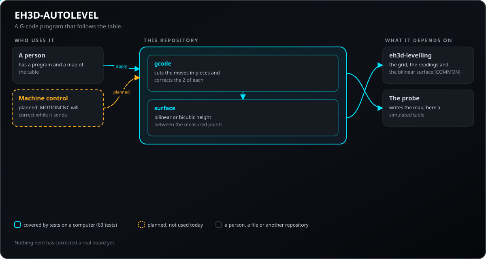
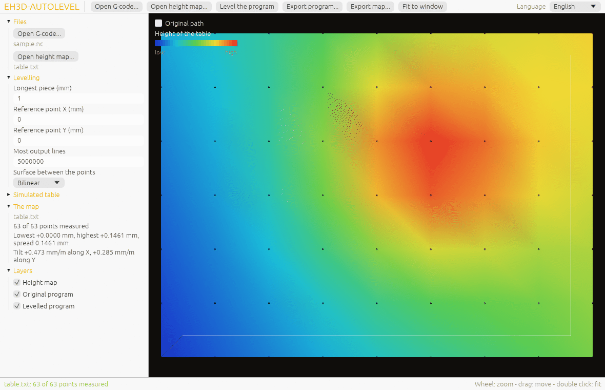
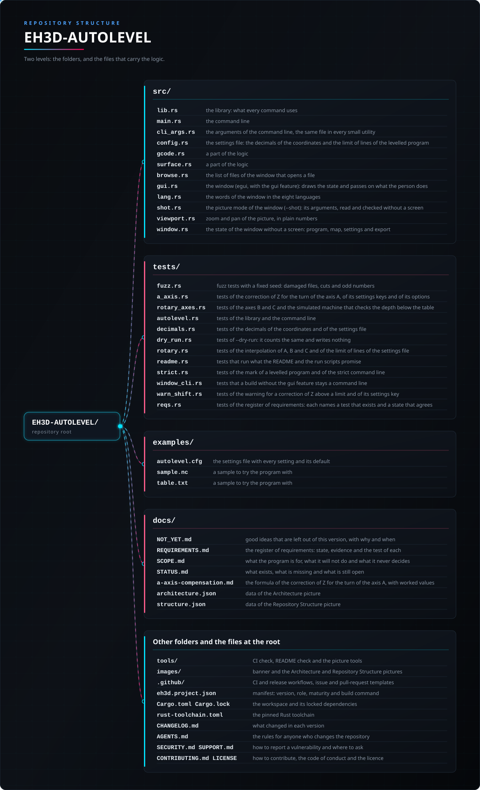

<p align="center">
  
</p>

#  EH3D-AUTOLEVEL
<p align="center"><a href="README.md">🇺🇸 English</a> | <a href="README_spa.md">🇪🇸 Español</a> | <a href="README_fra.md">🇫🇷 Français</a> | <a href="README_ita.md">🇮🇹 Italiano</a> | 🇩🇪 <b>Deutsch</b> | <a href="README_zho.md">🇨🇳 中文</a> | <a href="README_jpn.md">🇯🇵 日本語</a> | <a href="README_por.md">🇵🇹 Português</a></p>

### Korrigiert das Z eines G-Code-Programms mit der Höhenkarte des Tisches

<p align="center">
  
  
  
  
  
</p>

---

**Ehrlichkeitscheck - was heute wirklich läuft:** eine Rust-Bibliothek und ein Kommandozeilenprogramm (`eh3d-autolevel`) mit 293 Tests, die auf einem Computer laufen: korrigiert das Z eines G-Code-Programms mit der Höhenkarte des Tisches und schneidet die Bewegungen in Stücke, die der Oberfläche folgen. Es hat ein Fenster (Build mit `--features gui`), das ein G-Code-Programm und eine Höhenkarte öffnet, den Tisch als farbiges Netz mit den nivellierten Bahnen darüber zeigt und exportiert, aber das Fenster wurde noch nicht auf einem Bildschirm angesehen; wurde an keiner Maschine ausprobiert und nicht an einer Sammlung echter Dateien geprüft.

---

> **Sicherheitsstatus:** Dieses Programm steuert keine Maschine und ist kein Sicherheitssystem. Was es erzeugt, muss ein Mensch prüfen, bevor etwas an einer Maschine läuft; nichts davon lief auf echter Hardware.


## 📋 Auf einen Blick

| | |
|---|---|
| Version | `0.1.2` |
| Reifegrad | Funktionsfähig |
| Tests | 293 |
| Technologie-Stack | Rust |
| Auf echter Hardware | Nicht erprobt: nichts davon lief an einer Maschine |

**Springe zu:** [Überblick](#-überblick) · [Architektur](#-architektur) · [Schnellstart](#-schnellstart) · [Tests](#-tests) · [Struktur](#-struktur-des-repositorys) · [Verwandte](#-verwandte-projekte)

## 🚦 Projektstatus

Jede Zeile ist ein Teil dieses Repositorys, und die Ampel sagt, wie weit er heute ist. Sie beruht auf dem, was das Repository zeigen kann (Tests, Builds, Läufe), nicht auf dem, was geplant ist.

🟢 Fertig und überprüft · 🟡 Funktioniert, mit bekannten Grenzen · 🟠 Teilweise fertig oder noch nicht überprüft · 🔴 Nicht gemacht oder funktioniert nicht

| Bereich | Stand | Was das hier bedeutet |
|---|---|---|
| Kern | 🟡 | korrigiert das Z eines G-Code-Programms mit der Höhenkarte des Tisches und schneidet die Bewegungen in Stücke, die der Oberfläche folgen; am Computer mit normalen und beschädigten Eingaben getestet, nicht mit einer Sammlung echter Dateien. |
| Kommandozeile | 🟡 | `eh3d-autolevel` führt dieselben Funktionen wie die Bibliothek aus und gibt das Ergebnis aus; jeder Fehler kommt als Meldung mit einem Exit-Code ungleich null zurück. |
| Tests | 🟡 | 293 Tests bestehen (`cargo test`), mit Normalfällen, Grenzfällen und beschädigten Eingaben. Dazu gehört eine Simulation mit festem Seed für eine Antastsitzung mit den Fehlern des Tastknotens, mit eingespeisten Fehlern und Wiederherstellung. |
| Sicherheit | 🟡 | Reines sicheres Rust (`forbid(unsafe_code)`): nichts gerät bei den übergebenen Dateien in Panik und ein schlechter Wert ist ein Fehler mit Begründung; keine unabhängige Prüfung. |
| Fenster | 🟠 | Geschrieben (egui, `--features gui`): Programm und Höhenkarte öffnen oder hineinziehen, einen Tisch simulieren, den Tisch als farbiges Netz und die nivellierten Bahnen sehen, Zoom und Verschieben, die Nivellierung einstellen, exportieren; die Logik ist getestet, aber noch nicht gebaut oder auf einem Bildschirm angesehen. |
| Echte Hardware | 🔴 | Nicht erprobt: nichts davon wurde an einer Maschine ausgeführt. |
| Dokumentation | 🟡 | README in acht Sprachen, das Changelog und die zwei aus `docs/` gezeichneten Bilder. |

## 🎯 Überblick

* **Das Programm** (`src/gcode.rs`): Eine Schnittbewegung (G1) wird in Stücke geschnitten, die nicht länger als die gewählte Länge sind, und jedes Stück erhält das Z, das die Karte für sein Ende liefert; eine Eilbewegung (G0) wird nur korrigiert, wenn sie ein Z hat. Der Nullpunkt der Korrektur ist ein Bezugspunkt, an dem das Z des Auftrags gesetzt wurde.
* **Die Oberfläche** (`src/surface.rs`): bilinear (die der Karte in EH3D-COMMON) oder bikubisch (Catmull-Rom), die durch jeden gemessenen Punkt geht und einem gewölbten Tisch besser folgt; außerhalb des Gitters gilt die Höhe des nächsten Randes. `correct` zählt die Punkte außerhalb des gemessenen Bereichs und warnt davor, ebenso wenn der Bezugspunkt außerhalb liegt.
* **Was abgelehnt wird**, mit der Zeilennummer: relative Maße (G91), Zoll (G20), Bögen (G2, G3, außer mit `arcs = cut`), eine Bewegung vor jedem G0 oder G1, eine Zahl, die keine ist, eine Koordinate jenseits von einer Million Millimeter, eine Bewegung mit mehr als hunderttausend Stücken und eine Karte mit ungemessenen Punkten.
* **Strenge Kommandozeile:** Eine falsch geschriebene Option (`--powr`) oder ein überzähliges Wort ist ein Fehler, der sie nennt, und wird nicht ignoriert; sonst würde das Programm seine Ausgabe mit den Standardwerten erzeugen.
* **Nie zweimal nivelliert:** Das korrigierte Programm beginnt mit einer Kommentarzeile (`(eh3d-autolevel VERSION map=HASH ref=X,Y Methode seg=N)`), die sagt, dass es nivelliert wurde und mit welcher Karte; ein Programm mit dieser Zeile wird mit der Zeilennummer abgelehnt, denn eine erneute Korrektur würde die Korrektur des Tisches doppelt addieren.
* **Codes, die den Nullpunkt verschieben, werden abgelehnt:** G10, G28, G30, G38, G43, G53, G92 und jeder andere G-Code, der weder eine einfache Bewegung noch eine Einstellung ohne Positionsänderung ist, stoppen das Programm mit der Zeilennummer (früher wurden sie zu Bewegungen nach Z0); eine Verweilzeit (G4) und die `%`-Zeile am Anfang und Ende eines Programms laufen unverändert durch, und eine Karte ohne endliche Höhe wird abgelehnt, statt `Z NaN` zu schreiben.
* **`--dry-run`:** `apply` berechnet das Ergebnis und zählt es (Bewegungen, ergänzte Stücke, Z-Verschiebung), ohne die Ausgabedatei zu schreiben, die dann entfallen darf.

## 🧩 Rolle in EH3D

EH3D-AUTOLEVEL ist ein Programm der EH3D Fabrication Suite. Es arbeitet als Bibliothek und Kommandozeile und, mit `--features gui` gebaut, als Fenster im gemeinsamen Aussehen der Suite. Es liest und schreibt einfache Dateien und lässt sich allein oder zwischen den anderen Programmen nutzen.

## 🏛️ Architektur

<p align="center">
  
</p>


Wie die Teile dieses Repositorys zusammenpassen: wer es nutzt, was es enthält und wovon es abhängt. Das Bild wird aus `docs/architecture.json` gezeichnet und gegen den Code geprüft.

## 🖼️ Screenshots

<p align="center">
  
</p>

<p align="center"><em>Das Fenster mit einem Beispielprogramm und einer Höhenkarte: der Tisch von niedrig bis hoch eingefärbt, die gemessenen Punkte und der Pfad des Programms, links die Zusammenfassung der Karte.</em></p>

## ✨ Funktionen

* **Bibliothek und Kommandozeile:** Jeder Befehl von `eh3d-autolevel` ist eine Funktion der Bibliothek, sodass ein anderes Programm der Suite ihn ohne Prozessstart aufrufen kann.
* **Tests mit beschädigten Eingaben:** Die Tests füttern auch leere Dateien, Datenmüll, riesige Zahlen und abgeschnittene Dateien; keiner darf in Panik geraten.
* **Kein Raten:** Ein unsinniger Wert ist ein Fehler, der sagt welcher und warum, nie ein Ergebnis, das nur richtig aussieht.
* **Kein unsafe-Code:** `#![forbid(unsafe_code)]` in Bibliothek und Programm.
* **Zeilen, die keine Bewegungen sind, werden durchgereicht:** `$`-Befehle, `#`-Zuweisungen und die Meldungen `M117` und `M118` bleiben unverändert, die Prüfsumme einer nummerierten Zeile ist kein Wort, die Spindel- und Kühlmittelwörter (`M3` bis `M9`) einer zerlegten Bewegung gehören zum ersten Stück und die Endwörter (`M0`, `M1`, `M2`, `M30`) zum letzten, und `--max-lines` (standardmäßig 5000000) lehnt ein Programm mit mehr Ausgabezeilen ab.
* **Die Drehachsen A, B und C werden interpoliert:** wird eine Schneidbewegung in Stücke zerlegt, laufen ihre Wörter `A`, `B` und `C` geradlinig vom bisherigen Wert zu dem der Bewegung (sie sind modal und beginnen bei 0), mit denselben Dezimalstellen wie X, Y und Z; das letzte Stück endet genau auf dem Ziel, und das Z des Tisches kommt weiterhin nur aus X und Y. Ein Programm ohne Drehwörter wird wie bisher geschrieben.
* **Z-Kompensation für die Drehung der Achse A:** Mit `a-axis-compensation = tilt` und `a-axis-radius-mm = r` (oder `--a-compensation tilt --a-radius r`) wird zum Z jeder geschriebenen Bewegung nach der Höhe des Tisches `r * (1 - cos A)` addiert, mit A in Grad, wie die Bewegung sie hinterlässt (Stück für Stück interpoliert); Standard ist `off`, das keine Ausgabe verändert, und ein Hinweis auf der Fehlerausgabe sagt, wann sie angewendet wurde. Die Formel steht in `docs/a-axis-compensation.md`.
* **Die Achsen B und C:** Die Achse B (eine Drehung um Y) hat dieselbe Kompensation mit eigenem Radius (`b-axis-compensation = tilt` und `b-axis-radius-mm` in der Datei, `--b-compensation` und `--b-radius`), und beide addieren sich; die Achse C dreht um Z, ändert keine Höhe und braucht keine (ihre Wörter werden wie die von A und B mitgeführt und interpoliert). Eine simulierte Maschine geht das nivellierte Programm durch und prüft die Tiefe unter dem Tisch; auf einer Maschine mit Drehachsen lief nichts. **Ein Zug, der eine Achse auslässt:** standardmäßig gilt das Programm als bei 0 auf jeder Achse gestartet; `unknown-axis = refuse` (`--unknown-axis refuse`) lehnt mit der Zeilennummer einen Zug ab, der X, Y oder Z auslässt, bevor das Programm sie gesetzt hat.
* **Das nivellierte Programm beginnt mit dem Standardkopf:** der Erzeuger und seine Version, die Einheiten, das Ursprungsprogramm mit seinem SHA-256 und die Werkzeuge, als Kommentarzeilen vor der Markierung; die Tests lesen das Ergebnis mit dem Leser der Suite wieder ein und finden keine Warnung, keine Eilbewegung ins Material und keinen Schnitt bei stehender Spindel.
* **Zweifelhafte Messwerte, die Rauheit der Karte und die nicht gemessenen Punkte:** `info` und `apply` zeigen einen Punkt der Karte, der mehr als `--spike MM` (oder `spike-mm` in der Einstellungsdatei, von 0 bis 10 mm, standardmäßig 0,1, 0 für keine Prüfung) über oder unter dem liegt, was seine Nachbarn ergeben (ein abgerutschter Taster, ein Span unter der Spitze); aufgeführt wird nur der Punkt mit der größten Abweichung, und `apply` wird nie angehalten; `info` gibt außerdem die Fläche und den Abstand des Rasters, die Rauheit (den quadratischen Mittelwert des Abstands zur nächsten Ebene) und die Nummern der nicht gemessenen Punkte aus. `--json` gibt das Ergebnis von `info` oder `apply` als ein einziges JSON-Objekt für andere Programme aus, und `demo-map` nimmt `--noise MM`, `--seed N` und `--bad SPALTE,ZEILE,MM` an, um eine simulierte Karte mit Messfehlern und einem schlechten Punkt zu erzeugen, damit die Prüfung ausprobiert werden kann. Nur auf einem Computer getestet.
* **Bögen in Stücke geschnitten (standardmäßig aus):** mit `arcs = cut` in der Einstellungsdatei (oder `--arcs cut`) wird ein Bogen (G2, G3 in der Ebene von X und Y, mit I und J, mit R oder als Vollkreis) in gerade Stücke geschnitten, deren Enden auf dem Kreis liegen; `arc-tolerance-mm` (von 0,001 bis 1 mm, standardmäßig 0,01; `--arc-tolerance`) ist das Höchstmaß, um das ein Stück vom Bogen abweichen darf, ein Stück ist nie länger als das Segment, jedes Stück erhält das Z, das die Karte für sein Ende gibt, und Z verläuft geradlinig entlang des Bogens (eine Schraubenlinie). Ein Bogen ohne Mittelpunkt, mit zu kleinem Radius oder mit einem Ende, das nicht auf dem Kreis liegt, wird mit der Zeilennummer abgelehnt. Nur auf einem Computer erprobt.
* **Die Korrektur während des Sendens:** `eh3d-autolevel stream MAP.txt IN.nc` führt das Programm durch einen Sender, der es Zeile für Zeile nivelliert, wie es ein Sendeprogramm täte, in eine simulierte Maschine. Er hält an, mit ausgeschalteter Spindel und angehobenem Werkzeug, und endet mit dem Code 2, wenn eine Zeile mehr als `stream-outside-mm` aus dem gemessenen Bereich hinausgeht, unter `stream-min-z-mm` fahren würde, eine Z-Korrektur über `stream-max-shift-mm` erhält oder sich nicht nivellieren lässt; von dieser Zeile wird nichts gesendet. Die Grenzen und `stream-safe-z-mm` sind Schlüssel der Einstellungsdatei mit vorsichtigen Standardwerten. An eine echte Maschine wird nichts gesendet, und das Sendeprogramm der Suite ruft ihn noch nicht auf.
* **Die Startposition:** `--start X,Y,Z` oder `--start-report DATEI` (ein gespeicherter Statusbericht von GRBL oder die Antwort auf `M114` von Marlin, gelesen mit den Lesern der Controller-Crate der Suite) sagt, wo das Werkzeug beim Programmstart steht, statt auf jeder Achse 0 anzunehmen; das Z, das eine Maschine meldet, enthält schon die Korrektur des Tisches, daher wird das eigene Z des Programms daraus berechnet. Eine Maschine in Bewegung oder im Alarm oder ein Bericht ohne Arbeitsversatz liefert keine Position. Gegen den simulierten GRBL der Suite erprobt, nicht gegen eine echte Maschine.

## 🔒 Sicherheit und Schutz

| Bedrohung | Schutz |
|---|---|
| Eine beschädigte, abgeschnittene oder leere Datei | keine Panik: die Tests schneiden gültige Eingaben an jeder Stelle ab und füttern Datenmüll |
| Eine unsinnige Zahl (negativ, nicht endlich, absurd groß) | wird mit einem Fehler abgelehnt, der den Wert nennt; nichts wird zu etwas Plausiblem gerundet |
| Unsichere Speichernutzung | reines sicheres Rust mit `forbid(unsafe_code)` |

**Was nicht abgesichert ist:** Ein fehlerfrei erzeugtes Ergebnis ist kein geprüftes Ergebnis. Nichts hier kennt die Grenzen einer Maschine, und das Programm hatte keine unabhängige Prüfung. Eine Schwachstelle bitte privat melden (siehe [SECURITY.md](SECURITY.md)).

## 🔌 Schnittstellen

Die Bibliothek ist `eh3d_autolevel` (`use eh3d_autolevel::...`); die Kommandozeile ist `eh3d-autolevel`. Die Befehle sind diese; jeder gibt sein Ergebnis auf der Standardausgabe aus und meldet einen Fehler auf der Fehlerausgabe mit einem Exit-Code ungleich null. Es gibt keinen Netzwerkzugriff.

```text
eh3d-autolevel apply MAP.txt IN.nc OUT.nc [--segment 1.0] [--ref X,Y] [--bicubic] [--max-lines 5000000] [--decimals 3] [--warn-shift MM] [--a-compensation off|tilt] [--a-radius MM] [--spike MM] [--arcs refuse|cut] [--arc-tolerance MM] [--start X,Y,Z | --start-report FILE] [--config FILE] [--dry-run] [--json]
eh3d-autolevel stream MAP.txt IN.nc [--out FILE] [--arcs refuse|cut] [--start X,Y,Z | --start-report FILE] [--config FILE] [--json]   levels the program line by line as an emitter would send it, to a simulated machine; exit code 2 when it stops
eh3d-autolevel config                            every setting with its default, as a file
eh3d-autolevel info MAP.txt [--spike MM] [--json]   how many points, the area, the spread, the tilt and the roughness of the table, the points not measured and the doubtful readings
eh3d-autolevel demo-map OUT.txt X0 Y0 X1 Y1 COLS ROWS [--noise MM] [--seed N] [--bad COL,ROW,MM]    a map of a simulated tilted table with a bump
eh3d-autolevel [gui] [FILE...]                   the window (a build with --features gui); with no arguments it opens
```

## ⚙️ Konfiguration

Eine kleine Einstellungsdatei (`Schlüssel = Wert`, eine pro Zeile, `#` beginnt einen Kommentar) enthält, was sich einzustellen lohnt; heute hat sie fünf Schlüssel: `decimals`, mit wie vielen Dezimalstellen X, Y und Z im nivellierten Programm geschrieben werden (Standard 3, von 1 bis 6), und `max-lines`, die höchste Zeilenzahl des nivellierten Programms (Standard 5000000, von 1 bis 100000000). `eh3d-autolevel config` gibt die Datei mit allen Standardwerten aus (`examples/autolevel.cfg` ist diese Datei), `--config DATEI` liest eine, und `--decimals N` und `--max-lines N` geben dieselben Schlüssel auf der Kommandozeile an und gehen der Datei vor. Ein sinnloser Wert ist ein Fehler, der seine Zeile nennt. Der Rest wird als Argumente der Kommandozeile angegeben (siehe Schnittstellen), und jeder Standardwert steht in der Hilfe des Befehls (`eh3d-autolevel help`). Die festen Grenzen stehen als benannte Konstanten im Code und sind durch Tests abgedeckt. `warn-shift-mm` ist die Korrektur von Z in mm, ab der `apply` eine Warnung auf der Fehlerausgabe zeigt (standardmäßig 0: keine Warnung; von 0,001 bis 100); `--warn-shift MM` gibt sie auf der Kommandozeile an und hat Vorrang vor der Datei, und das korrigierte Programm wird trotzdem geschrieben. `a-axis-compensation` (`off` oder `tilt`, standardmäßig `off`; `--a-compensation`) und `a-axis-radius-mm` (der Abstand der Achse A zum Schnitt in mm, von -1000 bis 1000 und bei `tilt` nicht 0; `--a-radius`) addieren zu Z die Korrektur, die die Drehung der Achse A mit sich bringt (siehe `docs/a-axis-compensation.md`); die Optionen haben Vorrang vor der Datei. `spike-mm` ist der Betrag in mm, um den ein Punkt der Karte von dem abweichen darf, was seine Nachbarn ergeben, bevor `apply` und `info` ihn als zweifelhaften Messwert zeigen (standardmäßig 0,1, von 0 bis 10; 0 gibt keine Prüfung); `--spike MM` gibt ihn in der Befehlszeile an und gewinnt gegenüber der Datei. `arcs` (`refuse` oder `cut`, standardmäßig `refuse`; `--arcs`) und `arc-tolerance-mm` (von 0,001 bis 1, standardmäßig 0,01; `--arc-tolerance`) legen fest, ob ein Bogen in Stücke geschnitten wird und wie weit ein Stück von ihm abweichen darf; `stream-min-z-mm` (standardmäßig -10), `stream-max-shift-mm` (standardmäßig 2, 0 ohne Grenze), `stream-outside-mm` (standardmäßig 0) und `stream-safe-z-mm` (standardmäßig 5) sind die Grenzen des Senders von `stream`.

**Servermodus.** `apply --to-server` legt das korrigierte Programm als Artefakt auf dem EH3D-Server ab, mit der Karte, dem Verfahren und den Zahlen des Laufs, `info --json --to-server` legt das JSON der Karte ab und `demo-map --to-server` die soeben geschriebene Karte, damit die anderen Programme der Suite (auch ISOCAM liest die Höhenkarte) sie dort finden. Die Verbindung ist der eine Client der Suite (`eh3d-serverclient` aus EH3D-COMMON); ihre Schlüssel stehen in der Einstellungsdatei: `server_address` (`host:port`; leer bedeutet aus), `server_token` (nur schreibbar, wird nie angezeigt), `server_machine`, `server_timeout_s` (1 bis 120, Standard 15), `server_retries` (0 bis 5, Standard 2), `server_mdns` (Standard `off`) und `server_max_answer_mib` (1 bis 256, Standard 8). Die Ablehnungen des Servers werden anhand ihres Codes in der Sprache des Systems erklärt. `eh3d-autolevel server status --config FILE` zeigt die Einstellungen (das Token als `***`) und die Antwort des Servers. Ohne Adresse wird nichts gesendet, und die lokale Arbeit hängt nie vom Server ab.

## 🚀 Schnellstart

Sie brauchen eine stabile Rust-Toolchain (1.88 oder neuer).

```bash
cargo build --release
cargo test
cargo run --release -- info examples/table.txt
cargo run --release --features gui   # the window
cargo run --release --features gui -- --shot screen.png examples/sample.nc   # a picture of the window
```

Um ein Bild des Fensters aufzunehmen, ohne es von Hand zu öffnen, starten Sie es mit `--shot DATEI.png` (auch `--size WxH`, `--theme forge|dark|light`, `--wait N`, `--lang CODE`, `--open FILE`, `--replace`): Es öffnet sich in dieser Größe, speichert das PNG, behält keine Einstellungen und schließt sich selbst (Exit-Code 0, wenn die Datei geschrieben wurde, 1, wenn nicht, 2 bei falschen Argumenten).

## 🧪 Tests

Die Suite hat 293 Tests (`cargo test`, in der CI unter Windows und Linux). Sie prüfen Normalfälle, Grenzfälle und beschädigte Eingaben: leere Dateien, Datenmüll und abgeschnittene Dateien lösen nie eine Panik aus. Die CI führt außerdem `cargo fmt --check`, `cargo clippy` mit Warnungen als Fehlern und `python -I tools/ci_validate.py` aus.

## 🏗️ Build und Veröffentlichung

Die Version steht in `Cargo.toml` und in `eh3d.project.json`; jede Version hat ihren Eintrag in [CHANGELOG.md](CHANGELOG.md). `build.bat` / `build.sh` bauen das Programm, `test.bat` / `test.sh` führen die Tests aus und `run.bat` / `run.sh` starten es mit einem Beispiel. Releases erscheinen auf GitHub.

### Downloads

Jede Version enthält das Programm mit seinem Fenster für Windows (64 und 32 Bit), Linux (64 Bit) und macOS (Apple Silicon und Intel) als `<Name>-<Version>-<System>.zip` (Windows) oder `.tar.gz` mit dem Programm, der Lizenz, der Readme, dem Symbol und den Beispielen. Die Dateien werden von GitHub Actions gebaut, stehen in `SHA256SUMS` und sind mit dem EH3D-Schlüssel signiert. Um einen Download zu prüfen, vergleiche seinen Hash mit der danebenliegenden `.sha256`-Datei (`sha256sum -c`) und prüfe die Signatur mit der danebenliegenden `.sig`-Datei (`ssh-keygen -Y verify`).

## 📂 Struktur des Repositorys

<p align="center">
  
</p>

<details>
<summary>Textversion des Baums</summary>

```text
EH3D-AUTOLEVEL/
├── src/
│   ├── lib.rs                                   die Bibliothek: was jeder Befehl nutzt
│   ├── main.rs                                  die Kommandozeile
│   ├── cli_args.rs                              die Argumente der Kommandozeile, dieselbe Datei in jedem kleinen Werkzeug
│   ├── config.rs                                die Einstellungsdatei: die Dezimalstellen der Koordinaten und die Zeilengrenze des nivellierten Programms
│   ├── gcode.rs                                 ein Teil der Logik
│   ├── arcs.rs                                  Bögen (G2, G3) in gerade Stücke innerhalb einer Toleranz geschnitten
│   ├── stream.rs                                der Sender, der zeilenweise nivelliert, seine Grenzen und eine simulierte Maschine
│   ├── start.rs                                 die Startposition, von einer Steuerung oder einem gespeicherten Bericht gelesen
│   ├── surface.rs                               ein Teil der Logik
│   ├── browse.rs                                die Dateiliste des Fensters zum Öffnen einer Datei
│   ├── gui.rs                                   das Fenster (egui, mit dem Feature gui): zeichnet den Zustand und gibt weiter, was die Person tut
│   ├── lang.rs                                  die Wörter des Fensters in den acht Sprachen
│   ├── shot.rs                                  der Bildmodus des Fensters (--shot): seine Argumente, ohne Bildschirm gelesen und geprüft
│   ├── viewport.rs                              Zoom und Verschiebung des Bildes, in einfachen Zahlen
│   └── window.rs                                der Zustand des Fensters ohne Bildschirm: Programm, Karte, Einstellungen, Export
├── tests/
│   ├── fuzz.rs                                  Tests mit festem Startwert: beschädigte Dateien, Abschnitte und seltsame Zahlen
│   ├── a_axis.rs                                Tests der Z-Korrektur für die Drehung der Achse A, ihrer Einstellungsschlüssel und ihrer Optionen
│   ├── arcs.rs                                  Tests des Schneidens von Bögen, ihrer Toleranz und ihrer Einstellungen
│   ├── streaming.rs                             Tests des Senders: sicherer Halt, Grenzen und der Befehl mit Code 2
│   ├── start_pos.rs                             Tests der Startposition aus einer simulierten Maschine und aus Berichten
│   ├── rotary_axes.rs                           Tests der Achsen B und C und der simulierten Maschine, die die Tiefe unter dem Tisch prüft
│   ├── autolevel.rs                             Tests von Bibliothek und Kommandozeile
│   ├── decimals.rs                              Tests der Dezimalstellen der Koordinaten und der Einstellungsdatei
│   ├── dry_run.rs                               Tests von --dry-run: zählt dasselbe und schreibt nichts
│   ├── rotary.rs                                Tests der Interpolation von A, B und C und der Zeilengrenze der Einstellungsdatei
│   ├── readme.rs                                Tests, die ausführen, was README und run-Skripte versprechen
│   ├── strict.rs                                Tests der Markierung eines nivellierten Programms und der strengen Kommandozeile
│   ├── window_cli.rs                            Tests, dass ein Build ohne das Feature gui eine reine Kommandozeile bleibt
│   ├── warn_shift.rs                            Tests der Warnung bei einer Z-Korrektur über einer Grenze und ihres Einstellungsschlüssels
│   └── reqs.rs                                  Tests des Anforderungsregisters: jede nennt einen vorhandenen Test und einen passenden Stand
├── examples/
│   ├── autolevel.cfg                            die Einstellungsdatei mit jeder Einstellung und ihrem Standardwert
│   ├── sample.nc                                ein Beispiel zum Ausprobieren
│   └── table.txt                                ein Beispiel zum Ausprobieren
├── docs/
│   ├── NOT_YET.md                               gute Ideen außerhalb dieser Version, mit Grund und Zeitpunkt
│   ├── REQUIREMENTS.md                          das Register der Anforderungen: Stand, Nachweis und Test jeder einzelnen
│   ├── SCOPE.md                                 wofür es da ist, was es nicht tut und was es nie entscheidet
│   ├── STATUS.md                                was es gibt, was fehlt und was offen ist
│   ├── a-axis-compensation.md                   die Formel der Z-Korrektur für die Drehung der Achse A, mit berechneten Werten
│   ├── architecture.json                        Daten des Architektur-Bildes
│   └── structure.json                           Daten des Struktur-Bildes
├── tools/                                       CI-Prüfung, README-Prüfung und die Bildwerkzeuge
├── images/                                      Banner und die Bilder von Architektur und Repository-Struktur
├── .github/                                     CI- und Release-Workflows, Vorlagen für Issues und Pull Requests
├── eh3d.project.json                            Manifest: Version, Rolle, Reifegrad und Build-Befehl
├── Cargo.toml Cargo.lock                        der Workspace und seine festgelegten Abhängigkeiten
├── rust-toolchain.toml                          die festgelegte Rust-Toolchain
├── CHANGELOG.md                                 was sich in jeder Version geändert hat
├── AGENTS.md                                    die Regeln für alle, die das Repository ändern
├── SECURITY.md SUPPORT.md                       Schwachstellen melden und Fragen stellen
└── CONTRIBUTING.md CODE_OF_CONDUCT.md LICENSE   Mitwirken, Verhaltenskodex und Lizenz
```

</details>

## 🗺️ Roadmap und bekannte Grenzen

**Bekannte Grenzen heute**

* Das Fenster wurde noch nicht auf einem Bildschirm angesehen und kann keinen Tisch messen: Die Karte wird aus einer Datei geöffnet oder simuliert.
* Es wurde weder an einer Maschine noch mit einer Sammlung echter Dateien erprobt und hatte keine unabhängige Prüfung.
* Bögen werden abgelehnt, solange `arcs = cut` sie nicht in Stücke schneidet, das Programm beginnt angenommen bei X0 Y0 Z0, solange die Startposition nicht angegeben ist, der Sender ist nur gegen eine simulierte Maschine erprobt, und die Karte stammt von der Sonde der Suite oder einem simulierten Tisch, nicht von einer echten Messung.

**Als Nächstes**

* Das Sendeprogramm der Suite den Sender aufrufen lassen, die Startposition von einer echten Maschine lesen, Bögen in den Ebenen X–Z und Y–Z und Bögen, die als Bögen erhalten bleiben.
* Das Fenster auf einem Bildschirm ansehen und fertigstellen.
* Mit echten Dateien und den anderen Programmen der Suite ausprobieren.

## 🌍 Sprachen

README und Texte gibt es auf Englisch, Spanisch, Französisch, Italienisch, Deutsch, Chinesisch, Japanisch und europäischem Portugiesisch.

## 🔗 Verwandte Projekte

* [EH3D-COMMON](https://github.com/JuanenRac/EH3D-COMMON): der Projektcontainer und die gemeinsamen Typen der Suite
* [EH3D-PHOENIX-CNC](https://github.com/JuanenRac/EH3D-PHOENIX-CNC): das Maschinensteuerungsprogramm
* [EH3D-ISOCAM](https://github.com/JuanenRac/EH3D-ISOCAM): das Isolationsfräsen von Kupfer
* [EH3D-ROUTEPRO](https://github.com/JuanenRac/EH3D-ROUTEPRO): das Konturfräsprogramm
* [EH3D-CAM-DEBUGGER](https://github.com/JuanenRac/EH3D-CAM-DEBUGGER): die Prüfung von G-Code, bevor er eine Maschine erreicht

## 📚 Dokumentation

* [Changelog](CHANGELOG.md)
* [Umfang](docs/SCOPE.md): wofür das Programm da ist, was es nicht tut und was es nie entscheidet.
* [Anforderungen](docs/REQUIREMENTS.md): das Register der Fähigkeiten, der Stand jeder einzelnen und der Test, der sie zeigt.
* [Stand](docs/STATUS.md): was es gibt, was fehlt und was noch offen ist.
* [Noch nicht](docs/NOT_YET.md): gute Ideen, die in dieser Version fehlen.
* [Regeln für Änderungen am Repository](AGENTS.md): die Regeln für alle, die das Repository ändern.
* [Architektur- und Strukturdaten](docs/architecture.json): die Daten, aus denen die beiden Bilder gezeichnet werden.

## 🤝 Mitwirken und Community

* Vor einem Pull Request `cargo fmt --check`, `cargo clippy --all-targets -- -D warnings`, `cargo test` und `python -I tools/ci_validate.py` ausführen: alles muss bestehen. Siehe [CONTRIBUTING.md](CONTRIBUTING.md) und den [Verhaltenskodex](CODE_OF_CONDUCT.md).
* Die README gibt es in acht Sprachen: Eine Textänderung erfolgt in allen acht Dateien, und die zwei Bilder werden aus `docs/architecture.json` und `docs/structure.json` mit `tools/make_architecture.py` und `tools/make_structure.py` gezeichnet.
* Eine Schwachstelle privat melden: [SECURITY.md](SECURITY.md). Fragen, Ideen und Berichte: electrohobby3d@gmail.com ([SUPPORT.md](SUPPORT.md)).

## 👤 AUTOR

**JuanenRac (Electro Hobby 3D)** · electrohobby3d@gmail.com

## 📜 LIZENZ

Software: GPL-3.0-or-later. Siehe [LICENSE](LICENSE). Die Hardware-Entwürfe der Suite verwenden die CERN OHL-S.
