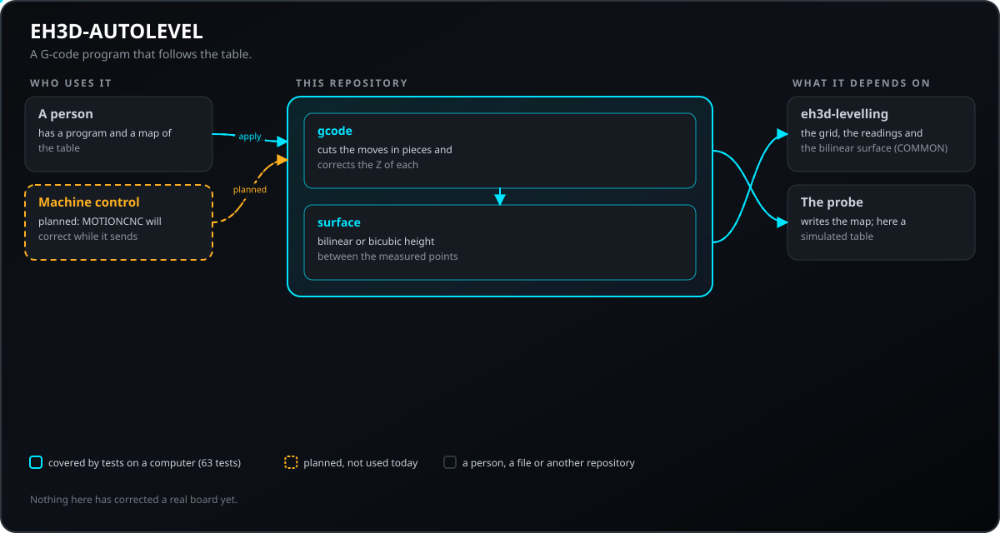
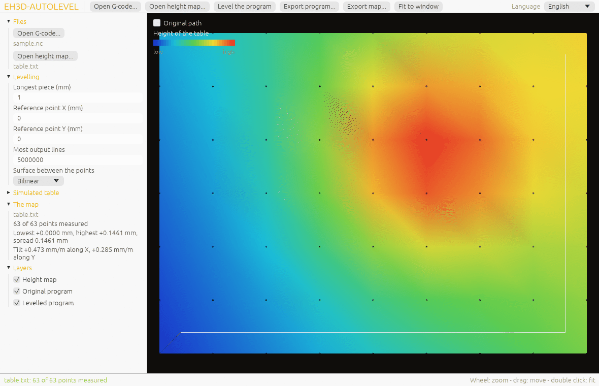
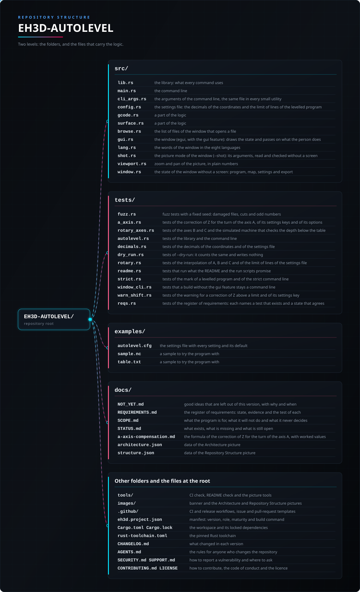

<p align="center">
  
</p>

#  EH3D-AUTOLEVEL
<p align="center"><a href="README.md">🇺🇸 English</a> | <a href="README_spa.md">🇪🇸 Español</a> | <a href="README_fra.md">🇫🇷 Français</a> | <a href="README_ita.md">🇮🇹 Italiano</a> | <a href="README_deu.md">🇩🇪 Deutsch</a> | <a href="README_zho.md">🇨🇳 中文</a> | 🇯🇵 <b>日本語</b> | <a href="README_por.md">🇵🇹 Português</a></p>

### テーブルの高さマップで G コード プログラムの Z を補正

<p align="center">
  
  
  
  
  
</p>

---

**正直さの確認 - 現在実際に動くもの：** Rust ライブラリとコマンドライン プログラム（`eh3d-autolevel`）で、コンピューター上で実行される 304 件のテストがあります：テーブルの高さマップで G コード プログラムの Z を補正し、移動を表面に沿った短い区間に分割します。ウィンドウ（`--features gui` でビルド）はG コード プログラムと高さマップを開き、テーブルを色付きメッシュで表示してその上に補正後のパスを重ね、書き出すが、画面ではまだ確認しておらず、機械では試しておらず、実際のファイルの集まりでも確認していません。

---

> **安全とセキュリティの状況：** このプログラムは機械を制御せず、安全システムでもありません。出力は、機械で何かを実行する前に人が確認する必要があります。ここにあるものは実機で動かしたことがありません。


## 📋 ひと目で

| | |
|---|---|
| バージョン | `0.1.4` |
| 成熟度 | 機能する |
| テスト | 304 |
| 技術スタック | Rust |
| 実機での動作 | 未試験：ここにあるものは機械で動かしたことがありません |

**移動先：** [概要](#-概要) · [アーキテクチャ](#-アーキテクチャ) · [クイックスタート](#-クイックスタート) · [テスト](#-テスト) · [構成](#-リポジトリの構成) · [関連](#-関連プロジェクト)

## 🚦 プロジェクトの状況

各行はこのリポジトリの一部分で、信号は今日どこまで進んでいるかを示します。計画ではなく、リポジトリが示せるもの（テスト、ビルド、実行）に基づいて書かれています。

🟢 完了・検証済み · 🟡 動作する（既知の制限あり） · 🟠 一部のみ、または未検証 · 🔴 未実装または動作しない

| 領域 | 状態 | ここでの意味 |
|---|---|---|
| コア | 🟡 | テーブルの高さマップで G コード プログラムの Z を補正し、移動を表面に沿った短い区間に分割します。コンピューター上で通常入力と破損入力でテスト済み。実際のファイルの集まりでは未確認。 |
| コマンドライン | 🟡 | `eh3d-autolevel` はライブラリと同じ関数を実行して結果を表示します。エラーはメッセージと 0 以外の終了コードで返ります。 |
| テスト | 🟡 | 304 件のテストが通ります（`cargo test`）。通常ケース、境界ケース、破損入力を含みます。固定シードによるプローブノードの障害を含む測定セッションのシミュレーション（障害の注入と復旧を含む）も含まれます。 |
| セキュリティ | 🟡 | 安全な Rust のみ（`forbid(unsafe_code)`）。受け取ったファイルでパニックせず、不正な値は理由付きのエラーになります。独立したレビューはありません。 |
| ウィンドウ | 🟠 | 作成済み（egui、`--features gui`）：プログラムと高さマップを開くかドロップ、テーブルのシミュレート、色付きメッシュのテーブルと補正後のパスの表示、拡大縮小と移動、補正の設定、書き出し。ロジックはテスト済みですが、まだビルドも画面での確認もしていません。 |
| 実機 | 🔴 | 未試験：ここにあるものは機械で実行したことがありません。 |
| ドキュメント | 🟡 | 8 言語の README、変更履歴、`docs/` から描いた 2 枚の図。 |

## 🎯 概要

* **プログラム**（`src/gcode.rs`）：切削移動（G1）は指定した長さ以下の区間に分割され、各区間の終点にマップが与える Z が付きます。早送り（G0）は Z がある場合のみ補正します。補正のゼロは、ジョブの Z を設定した基準点です。
* **表面**（`src/surface.rs`）：双線形（EH3D-COMMON のマップのもの）または双三次（Catmull-Rom）。双三次はすべての測定点を通り、湾曲したテーブルにより良く追従します。グリッドの外では最も近い端の高さを使います。 `correct` は測定範囲の外にある点を数えて警告します。基準点が範囲の外にある場合も同様です。
* **拒否するもの**（行番号付き）：相対距離（G91）、インチ（G20）、円弧（G2、G3。`arcs = cut` の場合を除く）、G0 や G1 より前の移動、数値でない数値、100 万 mm を超える座標、10 万区間を超える移動、未測定の点があるマップ。
* **厳密なコマンドライン：** 書き間違えたオプション（`--powr`）や余分な語は無視されず、それを名指しするエラーになります。そうでないと、プログラムは既定値で出力を作ってしまいます。
* **二度は補正しない：** 補正後のプログラムは、補正済みであることと使ったマップを示すコメント行（`(eh3d-autolevel VERSION map=HASH ref=X,Y 方式 seg=N)`）で始まります。この行を持つプログラムは行番号付きで拒否されます。もう一度補正するとテーブルの補正が二重に加わるためです。
* **原点を動かすコードは拒否されます：** G10、G28、G30、G38、G43、G53、G92、および単純な移動でも位置を変えない設定でもない G コードは、行番号を示してプログラムを止めます（以前は Z0 への移動に変換されていました）。ドウェル（G4）とプログラムの先頭・末尾の `%` 行はそのまま通り、有限の高さを返さないマップは `Z NaN` を書かずに拒否されます。
* **全体を読み取れない行は拒否します：** チェックサムではない `*`、二重に書かれた語、1行にある2つの移動コードまたは主軸コード、代入の後に何かが続くパラメータ行、制御文字があると、行番号を示してプログラムを停止します。
* **`--dry-run`：** `apply` は結果を計算して集計し（移動数、追加された区間、Zのずれ）、出力ファイルは書き出しません（その場合は省略できます）。

## 🧩 EH3D での役割

EH3D-AUTOLEVEL は EH3D Fabrication Suite のプログラムの一つです。ライブラリとコマンドラインとして動作し、`--features gui` でビルドすると、スイートの他のプログラムと共通の外観のウィンドウとしても動作します。単純なファイルを読み書きするため、単独でも他のプログラムの間でも使えます。

## 🏛️ アーキテクチャ

<p align="center">
  
</p>


このリポジトリの各部分の関係：誰が使い、何を持ち、何に依存するか。図は `docs/architecture.json` から描かれ、コードと照合されます。

## 🖼️ スクリーンショット

<p align="center">
  
</p>

<p align="center"><em>サンプルのプログラムと高さマップを開いたウィンドウ：低い所から高い所まで色分けしたテーブル、測定した点、プログラムの経路を表示し、左側にマップの概要を表示します。</em></p>

## ✨ 機能

* **ライブラリとコマンドライン：** `eh3d-autolevel` の各コマンドはライブラリの関数なので、スイートの他のプログラムがプロセスを起動せずに呼び出せます。
* **破損入力のテスト：** 空のファイル、ゴミデータ、巨大な数値、途中で切れたファイルも与え、どれもパニックしてはいけません。
* **推測しない：** 意味のない値は、どの値かと理由を示すエラーになり、見かけだけ正しい結果にはなりません。
* **unsafe コードなし：** ライブラリとプログラムに `#![forbid(unsafe_code)]`。
* **移動でない行はそのまま通します：** `$` コマンド、`#` の代入、メッセージ `M117` と `M118` はそのまま書き出し、番号付き行のチェックサムは語として扱わず、分割した移動のスピンドル・クーラント語（`M3`～`M9`）は最初の断片に、終了語（`M0`、`M1`、`M2`、`M30`）は最後の断片に付け、`--max-lines`（既定は 5000000）は出力行数がそれを超えるプログラムを拒否します。ジョグ（`$J=`）、原点復帰（`$H`）、および照会（`$`、`$$`、`$#`、`$G`、`$I`、`$N`）以外のすべての `$` コマンドは行番号を示して拒否し、行の途中に復帰文字がある行も拒否します。`apply` と `stream --out` の出力先が、読み込むプログラムやマップになることはありません。そのまま出力される行のコメントに、GRBL が即座に実行する `!`、`~`、`?` がある場合、`stream` は停止します。`apply` とウィンドウはプログラムを書き出し、最初の該当行を示して警告します（`realtime-character`）。アクセント付きの文字などの ASCII 以外の文字はコメントの中では使えます。GRBL はそのバイトの一部を命令として受け取るため、そのまま出力される行では `_` として書き出されます。コメントの外にあるそのような文字では `stream` は停止します。
* **回転軸 A、B、C を補間します：** 切削移動を断片に分割するとき、`A`、`B`、`C` の語は元の値から移動の指定値まで直線で変化し（モーダルで、初期値は0）、X、Y、Z と同じ小数桁数で書かれます。最後の断片は目標値にぴったり一致し、テーブルの Z は引き続き X と Y だけから求めます。回転軸の語がないプログラムはこれまでどおり書き出されます。
* **A 軸の回転による Z 補正：** `a-axis-compensation = tilt` と `a-axis-radius-mm = r`（または `--a-compensation tilt --a-radius r`）を指定すると、書き出す各移動の Z に、テーブルの高さの後で `r * (1 - cos A)` が加算されます。A は移動が残す角度（度）で、片ごとに補間されます。既定は `off` で、出力は一切変わらず、適用されたときはエラー出力に通知が表示されます。式は `docs/a-axis-compensation.md` にあります。
* **B軸とC軸：** B軸（Y周りの回転）にはA軸と同じ補正があり、専用の半径を持ちます（ファイルでは `b-axis-compensation = tilt` と `b-axis-radius-mm`、コマンドラインでは `--b-compensation` と `--b-radius`）。両方の補正は加算されます。C軸はZ周りの回転で高さを変えないため補正は不要です（その語はAやBと同様に引き継がれ補間されます）。シミュレートした機械がレベリング後のプログラムをたどってテーブル下の深さを確認します。回転軸を持つ実機では何も実行していません。 **軸を省略した移動:** 既定ではプログラムはすべての軸で 0 から始まるものとして扱います。`unknown-axis = refuse`（`--unknown-axis refuse`）にすると、プログラムが設定する前に X、Y、Z を省略した移動を、行番号つきで拒否します。
* **レベリング後のプログラムは標準ヘッダで始まります:** 生成元とそのバージョン、単位、元のプログラムとそのSHA-256、工具が、印の前のコメント行として入ります。テストは結果をスイートのリーダーで読み直し、警告、材料への早送り、スピンドルが止まったままの切削が1つも見つからないことを確かめます。
* **疑わしい測定値、マップの粗さ、未測定の点：** `info` と `apply` は、隣接する点から得られる値より `--spike MM`（または設定ファイルの `spike-mm`、0〜10 mm、既定は 0.1、0 で確認なし）を超えて高いまたは低い点（滑ったプローブ、先端の下の切りくず）を表示します。最もずれている点だけを一覧し、`apply` を止めることはありません。`info` はさらに、グリッドの範囲と間隔、粗さ（最も近い平面までの距離の二乗平均平方根）、未測定の点の番号も表示します。`--json` は `info` または `apply` の結果を他のプログラム向けに 1 つの JSON オブジェクトとして表示し、`demo-map` は `--noise MM`、`--seed N`、`--bad 列,行,MM` を受け付けて、読み取り誤差と不良点を含む模擬マップを作り、確認を試せるようにします。コンピューター上でのみテストしています。
* **円弧の分割（既定ではオフ）：** 設定ファイルの `arcs = cut`（または `--arcs cut`）で、円弧（X と Y の平面の G2、G3。I と J、R、または全円）を、端点が円上にある直線の小片に分割します。`arc-tolerance-mm`（0.001〜1 mm、既定は 0.01、`--arc-tolerance`）は小片が円弧から外れてよい最大量で、小片はセグメント長より長くなりません。各小片の Z はマップがその端点について与える値になり、Z は円弧に沿って直線的に変化します（らせん）。中心がない、半径が小さすぎる、終点が円上にない円弧は、行番号付きで拒否されます。コンピュータ上でのみ試験済みです。
* **送信中の補正：** `eh3d-autolevel stream MAP.txt IN.nc` は、送信プログラムと同じように、プログラムを 1 行ずつ水平補正するエミッタに通して模擬機械へ送ります。ある行が測定範囲を `stream-outside-mm` を超えて外れる、`stream-min-z-mm` より下がる、Z の補正が `stream-max-shift-mm` を超える、または補正できない場合、スピンドルを止め工具を持ち上げて停止し、終了コード 2 で終わります。その行は何も送られません。上限と `stream-safe-z-mm` は設定ファイルのキーで、既定値は慎重です。実機には何も送らず、スイートの送信プログラムはまだこれを呼び出しません。
* **開始位置：** `--start X,Y,Z` または `--start-report FILE`（保存した GRBL のステータス報告、または Marlin の `M114` の応答。スイートのコントローラクレートの読み取り処理で読みます）で、全軸が 0 と仮定する代わりに、プログラム開始時の工具位置を指定します。機械が報告する Z にはすでにテーブルの補正が含まれているため、プログラム自身の Z はそこから求めます。移動中またはアラーム中の機械や、ワークオフセットのない報告は位置を与えません。スイートの模擬 GRBL に対して試験済みで、実機ではありません。

## 🔒 セキュリティと安全

| 脅威 | 対策 |
|---|---|
| 破損・途中切れ・空のファイル | パニックなし：テストは有効な入力をあらゆる位置で切り、ゴミデータも与えます |
| 意味のない数値（負、無限、極端に大きい） | 値を示すエラーで拒否され、もっともらしい値に丸められることはありません |
| 安全でないメモリ使用 | `forbid(unsafe_code)` の安全な Rust のみ |

**防御していないこと：** エラーなく作られた結果は、検証された結果ではありません。ここには機械の限界を知るものはなく、プログラムは独立したレビューを受けていません。脆弱性は非公開で報告してください（[SECURITY.md](SECURITY.md) 参照）。

## 🔌 インターフェース

ライブラリは `eh3d_autolevel`（`use eh3d_autolevel::...`）、コマンドラインは `eh3d-autolevel` です。コマンドは次のとおりで、結果は標準出力に表示され、エラーは標準エラー出力に 0 以外の終了コードで報告されます。ネットワークアクセスはありません。

```text
eh3d-autolevel apply MAP.txt IN.nc OUT.nc [--segment 1.0] [--ref X,Y] [--bicubic] [--max-lines 5000000] [--decimals 3] [--warn-shift MM] [--a-compensation off|tilt] [--a-radius MM] [--spike MM] [--arcs refuse|cut] [--arc-tolerance MM] [--start X,Y,Z | --start-report FILE] [--config FILE] [--dry-run] [--json]
eh3d-autolevel stream MAP.txt IN.nc [--out FILE] [--arcs refuse|cut] [--start X,Y,Z | --start-report FILE] [--config FILE] [--json]   levels the program line by line as an emitter would send it, to a simulated machine; exit code 2 when it stops
eh3d-autolevel config                            every setting with its default, as a file
eh3d-autolevel info MAP.txt [--spike MM] [--json]   how many points, the area, the spread, the tilt and the roughness of the table, the points not measured and the doubtful readings
eh3d-autolevel demo-map OUT.txt X0 Y0 X1 Y1 COLS ROWS [--noise MM] [--seed N] [--bad COL,ROW,MM]    a map of a simulated tilted table with a bump
eh3d-autolevel [gui] [FILE...]                   the window (a build with --features gui); with no arguments it opens
```

## ⚙️ 設定

調整する価値のある値は小さな設定ファイル（`キー = 値`、1行に1つ、`#` からコメント）に置きます。現在のキーは5つあります。`decimals` は補正後プログラムの X、Y、Z を何桁の小数で書くか（既定は3、1〜6）、`max-lines` は補正後プログラムの最大行数（既定は 5000000、1〜100000000）を決めます。`eh3d-autolevel config` はすべての既定値を含むファイルを出力し（`examples/autolevel.cfg` がそのファイルです）、`--config FILE` はファイルを読み、`--decimals N` と `--max-lines N` は同じキーをコマンドラインで与えてファイルより優先されます。意味のない値は、その行番号を示すエラーになります。それ以外はコマンドラインの引数で渡し（インターフェースを参照）、各既定値はコマンドのヘルプ（`eh3d-autolevel help`）に書かれています。固定の上限はコード内の名前付き定数で、テストで確認されています。 `warn-shift-mm` は、これを超える Z 補正があると `apply` がエラー出力に警告を表示する値（mm）です（既定は 0 で警告なし、0.001〜100）。コマンドラインの `--warn-shift MM` が設定ファイルより優先され、補正後のプログラムはそのまま書き出されます。`a-axis-compensation`（`off` または `tilt`、既定は `off`、オプションは `--a-compensation`）と `a-axis-radius-mm`（A 軸から切削点までの距離 mm、-1000〜1000 で、`tilt` では 0 以外、オプションは `--a-radius`）は、A 軸の回転で生じる補正を Z に加えます（`docs/a-axis-compensation.md` を参照）。オプションは設定ファイルより優先されます。 `spike-mm` は、`apply` と `info` が疑わしい測定値として表示する前に、マップの点が隣接点から得られる値と異なってよい量（mm、既定は 0.1、0〜10、0 で確認なし）です。コマンドラインでは `--spike MM` で指定でき、ファイルより優先されます。 `arcs`（`refuse` または `cut`、既定は `refuse`、`--arcs`）と `arc-tolerance-mm`（0.001〜1、既定 0.01、`--arc-tolerance`）は、円弧を分割するかどうかと、小片が円弧から外れてよい量を決めます。`stream-min-z-mm`（既定 -10）、`stream-max-shift-mm`（既定 2、0 で制限なし）、`stream-outside-mm`（既定 0）、`stream-safe-z-mm`（既定 5）は `stream` のエミッタの上限です。

**サーバーモード。** `apply --to-server` は補正したプログラムを、マップ、方式、実行結果の数値とともにアーティファクトとして EH3D サーバーに保存し、`info --json --to-server` はマップの JSON を、`demo-map --to-server` は書き出したばかりのマップを保存します。スイートの他のプログラム（ISOCAM も高さマップを読み込みます）がそこで見つけられます。 接続はスイート共通のクライアント（EH3D-COMMON の `eh3d-serverclient`）で、設定ファイルのキーは次のとおりです: `server_address`（`host:port`、空ならオフ）、`server_token`（書き込み専用で表示されません）、`server_machine`、`server_timeout_s`（1〜120、既定 15）、`server_retries`（0〜5、既定 2）、`server_mdns`（既定 `off`）、`server_max_answer_mib`（1〜256、既定 8）。サーバーの拒否はコードに基づき、システムの言語で説明されます。`eh3d-autolevel server status --config FILE` は設定（トークンは `***`）とサーバーの応答を表示します。アドレスがなければ何も送信されず、ローカルの作業がサーバーに依存することはありません。

## 🚀 クイックスタート

安定版の Rust ツールチェーン（1.88 以降）が必要です。

```bash
cargo build --release
cargo test
cargo run --release -- info examples/table.txt
cargo run --release --features gui   # the window
cargo run --release --features gui -- --shot screen.png examples/sample.nc   # a picture of the window
```

手動で開かずにウィンドウの画像を撮るには、`--shot FILE.png` を付けて実行します（`--size WxH`, `--theme forge|dark|light`, `--wait N`, `--lang CODE`, `--open FILE`, `--replace` も使えます）。指定のサイズで開き、PNG を保存し、設定は保持せず、自動で閉じます（終了コードは、ファイルを書き込めたら 0、書けなければ 1、引数が誤りなら 2）。

## 🧪 テスト

テストは 304 件あります（`cargo test`、CI では Windows と Linux で実行）。通常ケース、境界ケース、破損入力を確認し、空のファイル、ゴミデータ、途中で切れたファイルでもパニックしません。CI は `cargo fmt --check`、警告をエラーにした `cargo clippy`、`python -I tools/ci_validate.py` も実行します。

## 🏗️ ビルドとリリース

バージョンは `Cargo.toml` と `eh3d.project.json` にあり、各バージョンは [CHANGELOG.md](CHANGELOG.md) に項目があります。`build.bat` / `build.sh` でビルド、`test.bat` / `test.sh` でテスト、`run.bat` / `run.sh` でサンプル実行します。リリースは GitHub で公開されます。

### ダウンロード

各バージョンには、Windows（64 ビットと 32 ビット）、Linux（64 ビット）、macOS（Apple silicon と Intel）向けの、ウィンドウ付きのプログラムが `<名前>-<バージョン>-<システム>.zip`（Windows）または `.tar.gz` として含まれ、プログラム、ライセンス、README、アイコン、サンプルが入っています。ファイルは GitHub Actions でビルドされ、`SHA256SUMS` に記載され、EH3D の鍵で署名されています。ダウンロードを確認するには、隣にある `.sha256` ファイルとハッシュを比較し（`sha256sum -c`）、隣にある `.sig` ファイルで署名を確認します（`ssh-keygen -Y verify`）。

## 📂 リポジトリの構成

<p align="center">
  
</p>

<details>
<summary>ツリーのテキスト版</summary>

```text
EH3D-AUTOLEVEL/
├── src/
│   ├── lib.rs                                   ライブラリ：各コマンドが使うもの
│   ├── main.rs                                  コマンドライン
│   ├── cli_args.rs                              コマンドライン引数：小さなツールすべてで同じファイル
│   ├── config.rs                                設定ファイル：補正後プログラムの座標の小数桁数と行数の上限
│   ├── gcode.rs                                 ロジックの一部
│   ├── arcs.rs                                  円弧（G2、G3）を許容差内の直線小片に分割
│   ├── stream.rs                                1行ずつ補正するエミッタ、その上限、模擬機械
│   ├── start.rs                                 コントローラまたは保存した報告から読む開始位置
│   ├── surface.rs                               ロジックの一部
│   ├── browse.rs                                ファイルを開くウィンドウのファイル一覧
│   ├── gui.rs                                   ウィンドウ（egui、gui 機能）：状態を描き、操作を伝える
│   ├── lang.rs                                  ウィンドウの文言（8言語）
│   ├── shot.rs                                  ウィンドウの画像モード（--shot）：画面なしで読み取り・検証される引数
│   ├── viewport.rs                              画像の拡大縮小と移動（単純な数値）
│   └── window.rs                                画面なしのウィンドウの状態：プログラム、マップ、設定、書き出し
├── tests/
│   ├── fuzz.rs                                  固定シードのテスト：壊れたファイル、途中切れ、異常な数値
│   ├── a_axis.rs                                A 軸の回転による Z 補正、その設定キーとオプションのテスト
│   ├── arcs.rs                                  円弧の分割、その許容差、設定のテスト
│   ├── streaming.rs                             エミッタのテスト：安全停止、上限、終了コード 2 のコマンド
│   ├── start_pos.rs                             模擬機械と報告から読む開始位置のテスト
│   ├── rotary_axes.rs                           B軸・C軸と、テーブル下の深さを確認するシミュレート機械のテスト
│   ├── autolevel.rs                             ライブラリとコマンドラインのテスト
│   ├── decimals.rs                              座標の小数桁数と設定ファイルのテスト
│   ├── dry_run.rs                               --dry-runのテスト：同じ数を数え、何も書かない
│   ├── rotary.rs                                A、B、C の補間と設定ファイルの行数上限のテスト
│   ├── readme.rs                                READMEとrunスクリプトが約束する内容を実行するテスト
│   ├── strict.rs                                補正済みプログラムの印と厳密なコマンドラインのテスト
│   ├── window_cli.rs                            gui 機能なしのビルドがコマンドラインのままであることのテスト
│   ├── warn_shift.rs                            上限を超える Z 補正の警告とその設定キーのテスト
│   └── reqs.rs                                  要件一覧のテスト：各要件は実在するテストと整合する状態を示す
├── examples/
│   ├── autolevel.cfg                            すべての設定と既定値を載せた設定ファイル
│   ├── sample.nc                                試すためのサンプル
│   └── table.txt                                試すためのサンプル
├── docs/
│   ├── NOT_YET.md                               このバージョンに含めない良いアイデアとその理由、再検討の時期
│   ├── REQUIREMENTS.md                          要件の一覧：それぞれの状態、証拠、テスト
│   ├── SCOPE.md                                 目的、行わないこと、決して判断しないこと
│   ├── STATUS.md                                存在するもの、足りないもの、未決のこと
│   ├── a-axis-compensation.md                   A 軸の回転による Z 補正の式と計算例
│   ├── architecture.json                        アーキテクチャ図のデータ
│   └── structure.json                           構成図のデータ
├── tools/                                       CI と README のチェック、図のツール
├── images/                                      バナーとアーキテクチャ・リポジトリ構成の図
├── .github/                                     CI とリリースのワークフロー、Issue と PR のテンプレート
├── eh3d.project.json                            マニフェスト：バージョン、役割、成熟度、ビルドコマンド
├── Cargo.toml Cargo.lock                        ワークスペースと固定された依存関係
├── rust-toolchain.toml                          固定されたRustツールチェーン
├── CHANGELOG.md                                 各バージョンの変更点
├── AGENTS.md                                    リポジトリを変更する人のための規則
├── SECURITY.md SUPPORT.md                       脆弱性の報告方法と問い合わせ先
└── CONTRIBUTING.md CODE_OF_CONDUCT.md LICENSE   貢献方法、行動規範、ライセンス
```

</details>

## 🗺️ ロードマップと既知の制限

**現時点で分かっている制限**

* ウィンドウはまだ画面で確認しておらず、テーブルを測定することもできません。マップはファイルから開くかシミュレートします。
* 機械でも実際のファイルの集まりでも試しておらず、独立したレビューも受けていません。
* 円弧は `arcs = cut` で分割しない限り拒否され、開始位置を指定しない限りプログラムは X0 Y0 Z0 から始まると仮定され、エミッタは模擬機械に対してのみ試験され、マップはスイートのプローブまたは模擬テーブルからで、実測ではありません。

**次のステップ**

* スイートの送信プログラムからエミッタを呼び出す、実機から開始位置を読み取る、X–Z 平面と Y–Z 平面の円弧、円弧を円弧のまま保つ。
* ウィンドウを画面で確認して仕上げる。
* 実際のファイルとスイートの他のプログラムで試す。

## 🌍 言語

README とテキストは、英語、スペイン語、フランス語、イタリア語、ドイツ語、中国語、日本語、ヨーロッパポルトガル語で提供されています。

## 🔗 関連プロジェクト

* [EH3D-COMMON](https://github.com/JuanenRac/EH3D-COMMON): プロジェクト コンテナーとスイート共通の型
* [EH3D-PHOENIX-CNC](https://github.com/JuanenRac/EH3D-PHOENIX-CNC): 機械制御プログラム
* [EH3D-ISOCAM](https://github.com/JuanenRac/EH3D-ISOCAM): 銅箔の絶縁ミリング
* [EH3D-ROUTEPRO](https://github.com/JuanenRac/EH3D-ROUTEPRO): 輪郭ミリング プログラム
* [EH3D-CAM-DEBUGGER](https://github.com/JuanenRac/EH3D-CAM-DEBUGGER): 機械に届く前の G コード検査

## 📚 ドキュメント

* [変更履歴](CHANGELOG.md)
* [スコープ](docs/SCOPE.md)： このプログラムの目的、行わないこと、決して判断しないこと。
* [要件](docs/REQUIREMENTS.md)： 機能の一覧、それぞれの状態、それを示すテスト。
* [状況](docs/STATUS.md)： 存在するもの、足りないもの、まだ未決のこと。
* [まだ対象外](docs/NOT_YET.md)： このバージョンに含めなかった良いアイデア。
* [リポジトリ変更の規則](AGENTS.md)： リポジトリを変更する人のための規則。
* [アーキテクチャと構成のデータ](docs/architecture.json)：2 枚の図を描くためのデータ。

## 🤝 コントリビュートとコミュニティ

* プルリクエストの前に `cargo fmt --check`、`cargo clippy --all-targets -- -D warnings`、`cargo test`、`python -I tools/ci_validate.py` を実行し、すべて通してください。[CONTRIBUTING.md](CONTRIBUTING.md) と[行動規範](CODE_OF_CONDUCT.md)を参照。
* README は 8 言語あります。文章の変更は 8 ファイルすべてで行い、2 枚の図は `tools/make_architecture.py` と `tools/make_structure.py` が `docs/architecture.json` と `docs/structure.json` から描きます。
* 脆弱性は非公開で報告してください：[SECURITY.md](SECURITY.md)。質問・提案・報告：electrohobby3d@gmail.com（[SUPPORT.md](SUPPORT.md)）。

## 👤 作者

**JuanenRac (Electro Hobby 3D)** · electrohobby3d@gmail.com

## 📜 ライセンス

ソフトウェア：GPL-3.0-or-later。[LICENSE](LICENSE) を参照。スイートのハードウェア設計には CERN OHL-S を使います。
