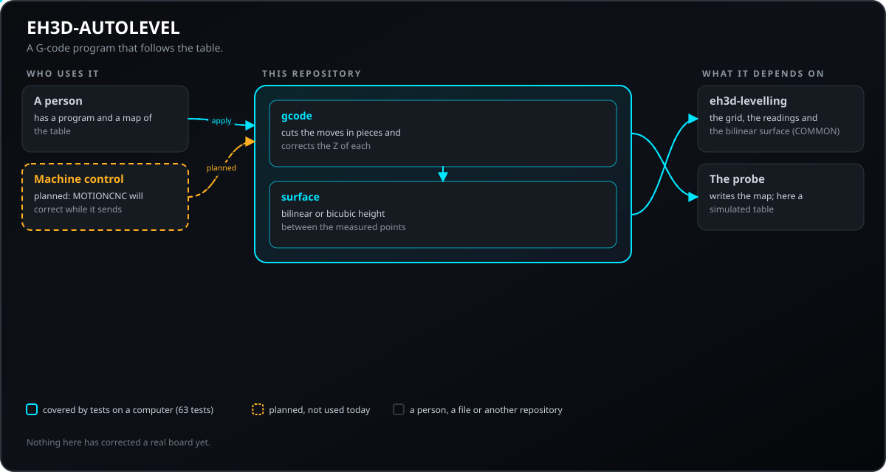
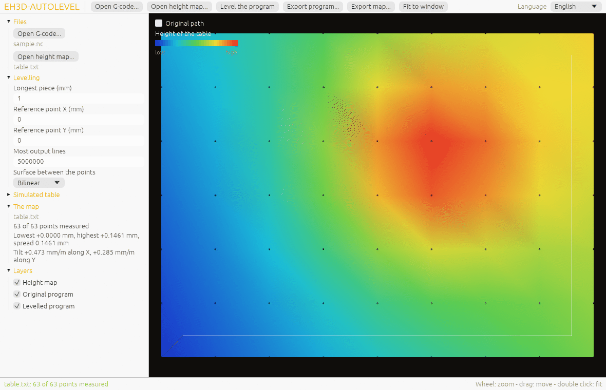
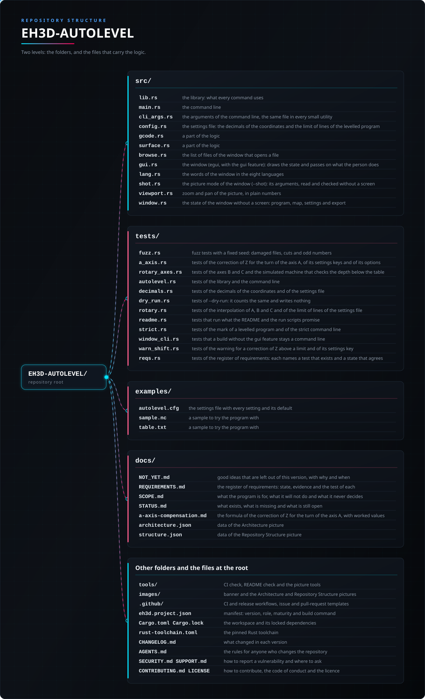

<p align="center">
  
</p>

#  EH3D-AUTOLEVEL
<p align="center"><a href="README.md">🇺🇸 English</a> | <a href="README_spa.md">🇪🇸 Español</a> | <a href="README_fra.md">🇫🇷 Français</a> | <a href="README_ita.md">🇮🇹 Italiano</a> | <a href="README_deu.md">🇩🇪 Deutsch</a> | <a href="README_zho.md">🇨🇳 中文</a> | <a href="README_jpn.md">🇯🇵 日本語</a> | 🇵🇹 <b>Português</b></p>

### Corrige o Z de um programa G-code com o mapa de alturas da mesa

<p align="center">
  
  
  
  
  
</p>

---

**Verificação de honestidade - o que funciona hoje:** uma biblioteca Rust e um programa de linha de comandos (`eh3d-autolevel`) com 287 testes que correm num computador: corrige o Z de um programa G-code com o mapa de alturas da mesa, partindo os movimentos em pedaços que seguem a superfície. Tem uma janela (compilada com `--features gui`) que abre um programa G-code e um mapa de alturas, mostra a mesa como uma malha colorida com as trajetórias niveladas por cima e exporta, mas a janela ainda não foi vista num ecrã; não foi experimentado numa máquina e não foi verificado com uma coleção de ficheiros reais.

---

> **Estado de segurança:** este programa não controla nenhuma máquina e não é um sistema de segurança. O que produz deve ser verificado por uma pessoa antes de se executar algo numa máquina; nada disto correu em hardware real.


## 📋 Num relance

| | |
|---|---|
| Versão | `0.1.2` |
| Maturidade | Funcional |
| Testes | 287 |
| Tecnologias | Rust |
| Em hardware real | Não experimentado: nada disto correu numa máquina |

**Ir para:** [Visão geral](#-visão-geral) · [Arquitetura](#-arquitetura) · [Início rápido](#-início-rápido) · [Testes](#-testes) · [Estrutura](#-estrutura-do-repositório) · [Relacionados](#-projetos-relacionados)

## 🚦 Estado do projeto

Cada linha é uma parte deste repositório e a luz diz até onde chega hoje. É escrita com o que o repositório consegue demonstrar (testes, compilações, execuções), não com o que está previsto.

🟢 Feito e verificado · 🟡 Funciona, com limites conhecidos · 🟠 Feito a meio ou ainda por verificar · 🔴 Por fazer ou a não funcionar

| Área | Estado | O que significa aqui |
|---|---|---|
| Núcleo | 🟡 | corrige o Z de um programa G-code com o mapa de alturas da mesa, partindo os movimentos em pedaços que seguem a superfície; testado num computador com entradas normais e danificadas, não com uma coleção de ficheiros reais. |
| Linha de comandos | 🟡 | `eh3d-autolevel` executa as mesmas funções da biblioteca e imprime o resultado; cada erro volta como mensagem e código de saída diferente de zero. |
| Testes | 🟡 | 287 testes passam (`cargo test`), com casos normais, casos-limite e entradas danificadas. Incluem uma simulação com semente fixa de uma sessão de apalpação com as falhas do nó apalpador, com falhas injetadas e recuperação. |
| Segurança | 🟡 | Rust seguro e simples (`forbid(unsafe_code)`): nada entra em pânico com os ficheiros recebidos e um valor mau é um erro com o seu motivo; sem revisão independente. |
| Janela | 🟠 | Escrita (egui, `--features gui`): abrir ou largar um programa e um mapa de alturas, simular uma mesa, ver a mesa como malha colorida e as trajetórias niveladas, zoom e deslocamento, ajustar o nivelamento, exportar; a sua lógica está testada, mas ainda não foi compilada nem vista num ecrã. |
| Hardware real | 🔴 | Não experimentado: nada disto foi executado numa máquina. |
| Documentação | 🟡 | README em oito idiomas, o registo de alterações e as duas imagens desenhadas a partir de `docs/`. |

## 🎯 Visão geral

* **O programa** (`src/gcode.rs`): um movimento de corte (G1) é partido em pedaços não mais compridos do que o comprimento escolhido e cada pedaço recebe o Z que o mapa dá para o seu fim; um movimento rápido (G0) só é corrigido se tiver Z. O zero da correção é um ponto de referência, onde se fixou o Z do trabalho.
* **A superfície** (`src/surface.rs`): bilinear (a do mapa do EH3D-COMMON) ou bicúbica (Catmull-Rom), que passa por todos os pontos medidos e segue melhor uma mesa curva; fora da grelha usa-se a altura da borda mais próxima. `correct` conta os pontos que ficam fora da área medida e avisa, tal como quando o ponto de referência está fora dela.
* **O que é recusado**, com o número da linha: distâncias relativas (G91), polegadas (G20), arcos (G2, G3, salvo com `arcs = cut`), um movimento antes de qualquer G0 ou G1, um número que não o é, uma coordenada além de um milhão de milímetros, um movimento que daria mais de cem mil pedaços e um mapa com pontos por medir.
* **Linha de comandos estrita:** uma opção mal escrita (`--powr`) ou uma palavra a mais é um erro que a nomeia, não algo que se ignora; caso contrário o programa faria a sua saída com os valores por omissão.
* **Nunca nivelado duas vezes:** o programa corrigido começa com uma linha de comentário (`(eh3d-autolevel VERSÃO map=HASH ref=X,Y método seg=N)`) que diz que foi nivelado e com que mapa; um programa que a traga é recusado com a sua linha, porque corrigi-lo outra vez somaria duas vezes a correção da mesa.
* **Os códigos que movem a origem são recusados:** G10, G28, G30, G38, G43, G53, G92 e qualquer outro código G que não seja um movimento simples nem uma definição que deixe a posição como está param o programa com o número da linha (antes eram convertidos em movimentos para Z0); uma espera (G4) e a linha `%` do início e do fim de um programa passam sem alterações, e um mapa sem altura finita é recusado em vez de escrever `Z NaN`.
* **`--dry-run`:** `apply` calcula o resultado e conta-o (movimentos, pedaços acrescentados, deslocamento de Z) sem escrever o ficheiro de saída, que então pode ser omitido.

## 🧩 Papel no EH3D

EH3D-AUTOLEVEL é um programa da EH3D Fabrication Suite. Funciona como biblioteca e linha de comandos e, compilado com `--features gui`, como janela com o aspeto que os outros programas da suíte partilham. Lê e escreve ficheiros simples, por isso pode ser usado sozinho ou entre os outros programas.

## 🏛️ Arquitetura

<p align="center">
  
</p>


Como as partes deste repositório se encaixam: quem o usa, o que contém e de que depende. A imagem é desenhada a partir de `docs/architecture.json` e verificada com o código.

## 🖼️ Capturas de ecrã

<p align="center">
  
</p>

<p align="center"><em>A janela com um programa e um mapa de alturas de exemplo: a mesa colorida de baixo para alto, os pontos medidos e o trajeto do programa, com o resumo do mapa à esquerda.</em></p>

## ✨ Funcionalidades

* **Biblioteca e linha de comandos:** cada comando de `eh3d-autolevel` é uma função da biblioteca, por isso outro programa da suíte pode chamá-la sem lançar um processo.
* **Testes com entradas danificadas:** os testes também dão ficheiros vazios, lixo, números enormes e ficheiros cortados, e nenhum pode entrar em pânico.
* **Sem adivinhar:** um valor sem sentido é um erro que diz qual e porquê, nunca um resultado que apenas parece certo.
* **Sem código unsafe:** `#![forbid(unsafe_code)]` na biblioteca e no programa.
* **As linhas que não são movimentos passam tal como estão:** os comandos `$`, as atribuições `#` e as mensagens `M117` e `M118` escrevem-se como estão, a soma de verificação de uma linha numerada não é uma palavra, as palavras de fuso e de refrigerante (`M3` a `M9`) de um movimento cortado vão com a sua primeira peça e as de fim (`M0`, `M1`, `M2`, `M30`) com a última, `--max-lines` (5000000 por omissão) recusa um programa com mais linhas de saída.
* **Os eixos rotativos A, B e C são interpolados:** quando um movimento de corte é cortado em peças, as suas palavras `A`, `B` e `C` vão em linha reta do valor que tinham para o do movimento (são modais e começam em 0), com as mesmas casas decimais que X, Y e Z; a última peça acaba exatamente no destino e o Z da mesa continua a vir só de X e Y. Um programa sem palavras rotativas escreve-se como antes.
* **Compensação de Z pela rotação do eixo A:** com `a-axis-compensation = tilt` e `a-axis-radius-mm = r` (ou `--a-compensation tilt --a-radius r`), ao Z de cada movimento escrito soma-se `r * (1 - cos A)` depois da altura da mesa, com A em graus tal como o movimento a deixa (interpolada peça a peça); por omissão é `off`, que não altera nenhuma saída, e um aviso na saída de erros diz quando foi aplicada. A fórmula está em `docs/a-axis-compensation.md`.
* **Os eixos B e C:** o eixo B (uma rotação em torno de Y) tem a mesma compensação com o seu próprio raio (`b-axis-compensation = tilt` e `b-axis-radius-mm` no ficheiro, `--b-compensation` e `--b-radius`) e as duas somam-se; o eixo C roda em torno de Z, não altera nenhuma altura e não precisa de nenhuma (as suas palavras são transportadas e interpoladas como as de A e B). Uma máquina simulada percorre o programa nivelado e verifica a profundidade abaixo da mesa; nada foi executado numa máquina com eixos rotativos. **Um movimento que omite um eixo:** por omissão o programa é tomado como começando em 0 em cada eixo; `unknown-axis = refuse` (`--unknown-axis refuse`) recusa, com o número da linha, um movimento que omite X, Y ou Z antes de o programa o ter definido.
* **O programa nivelado começa com o cabeçalho padrão:** o gerador e a sua versão, as unidades, o programa de origem com o seu SHA-256 e as ferramentas, como linhas de comentário antes da marca; os testes voltam a ler o resultado com o leitor da suite e não encontram nenhum aviso, nenhum movimento rápido para dentro do material nem nenhum corte com o fuso parado.
* **Leituras duvidosas, a rugosidade do mapa e os pontos por medir:** `info` e `apply` mostram um ponto do mapa que lê mais de `--spike MM` (ou `spike-mm` no ficheiro de definições, de 0 a 10 mm, 0,1 por predefinição, 0 para não verificar) acima ou abaixo do que dão os seus vizinhos (uma sonda que escorregou, uma apara debaixo da ponta), listando apenas o ponto que mais se afasta e sem nunca interromper `apply`; `info` imprime ainda a área e o espaçamento da grelha, a rugosidade (a distância quadrática média ao plano mais próximo) e os números dos pontos que não foram medidos. `--json` imprime o resultado de `info` ou de `apply` como um único objeto JSON para outros programas, e `demo-map` aceita `--noise MM`, `--seed N` e `--bad COL,LINHA,MM` para criar um mapa simulado com erros de leitura e um ponto mau, de modo a poder experimentar a verificação. Testado apenas num computador.
* **Arcos partidos em pedaços (desligado por omissão):** com `arcs = cut` no ficheiro de configuração (ou `--arcs cut`), um arco (G2, G3 no plano de X e Y, com I e J, com R ou como círculo completo) é partido em pedaços retos cujas extremidades estão sobre a circunferência; `arc-tolerance-mm` (de 0,001 a 1 mm, 0,01 por omissão; `--arc-tolerance`) é o máximo que um pedaço se pode afastar do arco, um pedaço nunca é mais comprido do que o segmento, cada pedaço recebe o Z que o mapa dá para a sua extremidade e o Z avança em linha reta ao longo do arco (uma hélice). Um arco sem centro, com um raio demasiado pequeno ou com uma extremidade que não está na circunferência é recusado com o número da linha. Testado apenas num computador.
* **A correção enquanto o programa é enviado:** `eh3d-autolevel stream MAP.txt IN.nc` passa o programa por um emissor que o nivela linha a linha, como faria um programa de envio, para uma máquina simulada. Pára, com o fuso desligado e a ferramenta levantada, e termina com o código 2 quando uma linha sai da área medida em mais de `stream-outside-mm`, desceria abaixo de `stream-min-z-mm`, recebe uma correção de Z além de `stream-max-shift-mm` ou não pode ser nivelada; dessa linha não se envia nada. Os limites e `stream-safe-z-mm` são chaves do ficheiro de configuração com valores por omissão prudentes. Nada é enviado a uma máquina real e o programa de envio da suíte ainda não o chama.
* **A posição inicial:** `--start X,Y,Z` ou `--start-report FICHEIRO` (um relatório de estado do GRBL guardado ou a resposta a `M114` do Marlin, lidos com os leitores do crate de controladores da suíte) diz onde está a ferramenta quando o programa começa, em vez de supor 0 em cada eixo; o Z que uma máquina indica já inclui a correção da mesa, por isso o Z próprio do programa calcula-se a partir dele. Uma máquina em movimento ou em alarme, ou um relatório sem o desvio de trabalho, não dá posição. Testado contra o GRBL simulado da suíte, não contra uma máquina real.

## 🔒 Segurança e proteção

| Ameaça | Defesa |
|---|---|
| Um ficheiro danificado, cortado ou vazio | sem pânico: os testes cortam uma entrada válida em cada posição e dão lixo |
| Um número sem sentido (negativo, não finito, absurdamente grande) | recusado com um erro que nomeia o valor; nada é arredondado para algo plausível |
| Uso inseguro de memória | Rust seguro e simples com `forbid(unsafe_code)` |

**O que não é defendido:** um resultado produzido sem erros não é um resultado verificado. Nada aqui conhece os limites de uma máquina e o programa não teve revisão independente. Comunique uma vulnerabilidade em privado (ver [SECURITY.md](SECURITY.md)).

## 🔌 Interfaces

A biblioteca é `eh3d_autolevel` (`use eh3d_autolevel::...`); a linha de comandos é `eh3d-autolevel`. Os comandos são estes; cada um imprime o resultado na saída padrão e comunica um erro na saída de erros com um código de saída diferente de zero. Não há acesso à rede.

```text
eh3d-autolevel apply MAP.txt IN.nc OUT.nc [--segment 1.0] [--ref X,Y] [--bicubic] [--max-lines 5000000] [--decimals 3] [--warn-shift MM] [--a-compensation off|tilt] [--a-radius MM] [--spike MM] [--arcs refuse|cut] [--arc-tolerance MM] [--start X,Y,Z | --start-report FILE] [--config FILE] [--dry-run] [--json]
eh3d-autolevel stream MAP.txt IN.nc [--out FILE] [--arcs refuse|cut] [--start X,Y,Z | --start-report FILE] [--config FILE] [--json]   levels the program line by line as an emitter would send it, to a simulated machine; exit code 2 when it stops
eh3d-autolevel config                            every setting with its default, as a file
eh3d-autolevel info MAP.txt [--spike MM] [--json]   how many points, the area, the spread, the tilt and the roughness of the table, the points not measured and the doubtful readings
eh3d-autolevel demo-map OUT.txt X0 Y0 X1 Y1 COLS ROWS [--noise MM] [--seed N] [--bad COL,ROW,MM]    a map of a simulated tilted table with a bump
eh3d-autolevel [gui] [FILE...]                   the window (a build with --features gui); with no arguments it opens
```

## ⚙️ Configuração

Um pequeno ficheiro de definições (`chave = valor`, uma por linha, `#` começa um comentário) guarda o que vale a pena ajustar; hoje tem cinco chaves: `decimals`, com quantas casas decimais se escrevem X, Y e Z no programa nivelado (3 por omissão, de 1 a 6), e `max-lines`, o máximo de linhas do programa nivelado (5000000 por omissão, de 1 a 100000000). `eh3d-autolevel config` imprime o ficheiro com cada valor por omissão (`examples/autolevel.cfg` é esse ficheiro), `--config FICHEIRO` lê um e `--decimals N` e `--max-lines N` dão as mesmas chaves na linha de comandos e prevalecem sobre o ficheiro. Um valor sem sentido é um erro que diz a sua linha. O resto é dado como argumentos da linha de comandos (ver Interfaces) e cada valor por omissão está escrito na ajuda do comando (`eh3d-autolevel help`). Os limites fixos são constantes com nome no código, cobertas por testes. `warn-shift-mm` é a correção de Z, em mm, acima da qual o `apply` mostra um aviso na saída de erros (0 por omissão: sem aviso; de 0,001 a 100); `--warn-shift MM` indica-a na linha de comandos e prevalece sobre o ficheiro, e o programa corrigido é escrito na mesma. `a-axis-compensation` (`off` ou `tilt`, `off` por omissão; `--a-compensation`) e `a-axis-radius-mm` (a distância em mm do eixo A ao corte, de -1000 a 1000 e diferente de 0 com `tilt`; `--a-radius`) somam a Z a correção que a rotação do eixo A traz (ver `docs/a-axis-compensation.md`); as opções prevalecem sobre o ficheiro. `spike-mm` é quanto, em mm, um ponto do mapa pode ler diferente do que dão os seus vizinhos antes de `apply` e `info` o mostrarem como leitura duvidosa (0,1 por predefinição, de 0 a 10; 0 não verifica); `--spike MM` indica-o na linha de comandos e prevalece sobre o ficheiro. `arcs` (`refuse` ou `cut`, `refuse` por omissão; `--arcs`) e `arc-tolerance-mm` (de 0,001 a 1, 0,01 por omissão; `--arc-tolerance`) dizem se um arco é partido em pedaços e quanto um pedaço se pode afastar dele; `stream-min-z-mm` (-10 por omissão), `stream-max-shift-mm` (2 por omissão, 0 sem limite), `stream-outside-mm` (0 por omissão) e `stream-safe-z-mm` (5 por omissão) são os limites do emissor de `stream`.

**Modo servidor.** `apply --to-server` guarda no servidor EH3D, como artefacto, o programa corrigido, com o mapa, o método e os números da execução, `info --json --to-server` guarda o JSON do mapa e `demo-map --to-server` o mapa que acabou de escrever, para que os outros programas da suite (o ISOCAM também lê o mapa de alturas) os encontrem lá. A ligação é o cliente único da suite (`eh3d-serverclient` do EH3D-COMMON) e as suas chaves ficam no ficheiro de definições: `server_address` (`host:port`; vazio significa desligado), `server_token` (só de escrita, nunca é mostrado), `server_machine`, `server_timeout_s` (1 a 120, 15 por omissão), `server_retries` (0 a 5, 2 por omissão), `server_mdns` (`off` por omissão) e `server_max_answer_mib` (1 a 256, 8 por omissão). As recusas do servidor são explicadas pelo seu código no idioma do sistema. `eh3d-autolevel server status --config FILE` mostra as definições (o token como `***`) e o que o servidor responde. Não se envia nada sem endereço e o trabalho local nunca depende do servidor.

## 🚀 Início rápido

Precisa de uma cadeia de ferramentas Rust estável (1.88 ou mais recente).

```bash
cargo build --release
cargo test
cargo run --release -- info examples/table.txt
cargo run --release --features gui   # the window
cargo run --release --features gui -- --shot screen.png examples/sample.nc   # a picture of the window
```

Para tirar uma captura da janela sem a abrir à mão, execute-o com `--shot FICHEIRO.png` (também `--size WxH`, `--theme forge|dark|light`, `--wait N`, `--lang CODE`, `--open FILE`, `--replace`): abre-se com esse tamanho, guarda o PNG, não guarda definições e fecha-se sozinho (código de saída 0 se o ficheiro foi escrito, 1 se não, 2 se os argumentos estiverem errados).

## 🧪 Testes

O conjunto tem 287 testes (`cargo test`, executados em Windows e Linux no CI). Verificam os casos normais, os casos-limite e as entradas danificadas: ficheiros vazios, lixo e ficheiros cortados nunca provocam pânico. O CI executa ainda `cargo fmt --check`, `cargo clippy` com avisos como erros e `python -I tools/ci_validate.py`.

## 🏗️ Compilação e publicação

A versão está em `Cargo.toml` e em `eh3d.project.json`; cada versão tem a sua entrada em [CHANGELOG.md](CHANGELOG.md). `build.bat` / `build.sh` compilam o programa, `test.bat` / `test.sh` executam os testes e `run.bat` / `run.sh` executam-no com um exemplo. As versões são publicadas no GitHub.

### Transferências

Cada versão traz o programa com a sua janela para Windows (64 e 32 bits), Linux (64 bits) e macOS (Apple silicon e Intel), como `<nome>-<versão>-<sistema>.zip` (Windows) ou `.tar.gz` com o programa, a licença, o leia-me, o ícone e os exemplos. Os ficheiros são construídos pelo GitHub Actions, constam de `SHA256SUMS` e estão assinados com a chave da EH3D. Para verificar uma transferência, compare o seu hash com o ficheiro `.sha256` que a acompanha (`sha256sum -c`) e verifique a assinatura com o ficheiro `.sig` que a acompanha (`ssh-keygen -Y verify`).

## 📂 Estrutura do repositório

<p align="center">
  
</p>

<details>
<summary>Versão em texto da árvore</summary>

```text
EH3D-AUTOLEVEL/
├── src/
│   ├── lib.rs                                   a biblioteca: o que cada comando usa
│   ├── main.rs                                  a linha de comandos
│   ├── cli_args.rs                              os argumentos da linha de comandos, o mesmo ficheiro em cada utilitário pequeno
│   ├── config.rs                                o ficheiro de definições: as casas decimais das coordenadas e o limite de linhas do programa nivelado
│   ├── gcode.rs                                 uma parte da lógica
│   ├── arcs.rs                                  arcos (G2, G3) partidos em pedaços retos dentro de uma tolerância
│   ├── stream.rs                                o emissor que nivela linha a linha, os seus limites e uma máquina simulada
│   ├── start.rs                                 a posição inicial, lida de um controlador ou de um relatório guardado
│   ├── surface.rs                               uma parte da lógica
│   ├── browse.rs                                a lista de ficheiros da janela que abre um ficheiro
│   ├── gui.rs                                   a janela (egui, com a funcionalidade gui): desenha o estado e transmite o que a pessoa faz
│   ├── lang.rs                                  as palavras da janela nos oito idiomas
│   ├── shot.rs                                  o modo de captura da janela (--shot): os seus argumentos, lidos e verificados sem ecrã
│   ├── viewport.rs                              zoom e deslocamento da imagem, em números simples
│   └── window.rs                                o estado da janela sem ecrã: programa, mapa, definições e exportação
├── tests/
│   ├── fuzz.rs                                  testes com semente fixa: ficheiros danificados, cortes e números estranhos
│   ├── a_axis.rs                                testes da correção de Z pela rotação do eixo A, das suas chaves de definições e das suas opções
│   ├── arcs.rs                                  testes do corte de arcos, da sua tolerância e das suas definições
│   ├── streaming.rs                             testes do emissor: a paragem segura, os limites e o comando com o código 2
│   ├── start_pos.rs                             testes da posição inicial lida de uma máquina simulada e de relatórios
│   ├── rotary_axes.rs                           testes dos eixos B e C e da máquina simulada que verifica a profundidade abaixo da mesa
│   ├── autolevel.rs                             testes da biblioteca e da linha de comandos
│   ├── decimals.rs                              testes das casas decimais das coordenadas e do ficheiro de definições
│   ├── dry_run.rs                               testes de --dry-run: conta o mesmo e não escreve nada
│   ├── rotary.rs                                testes da interpolação de A, B e C e do limite de linhas do ficheiro de definições
│   ├── readme.rs                                testes que executam o que o README e os scripts run prometem
│   ├── strict.rs                                testes da marca de um programa nivelado e da linha de comandos estrita
│   ├── window_cli.rs                            testes de que uma compilação sem a funcionalidade gui continua a ser só linha de comandos
│   ├── warn_shift.rs                            testes do aviso para uma correção de Z acima de um limite e da sua chave de definições
│   └── reqs.rs                                  testes do registo de requisitos: cada um nomeia um teste que existe e um estado coerente
├── examples/
│   ├── autolevel.cfg                            o ficheiro de definições com cada definição e o seu valor por omissão
│   ├── sample.nc                                um exemplo para experimentar o programa
│   └── table.txt                                um exemplo para experimentar o programa
├── docs/
│   ├── NOT_YET.md                               boas ideias fora desta versão, com o porquê e o quando
│   ├── REQUIREMENTS.md                          o registo de requisitos: estado, evidência e teste de cada um
│   ├── SCOPE.md                                 para que serve, o que não fará e o que nunca decide
│   ├── STATUS.md                                o que existe, o que falta e o que continua em aberto
│   ├── a-axis-compensation.md                   a fórmula da correção de Z pela rotação do eixo A, com valores calculados
│   ├── architecture.json                        dados da imagem de Arquitetura
│   └── structure.json                           dados da imagem de Estrutura
├── tools/                                       verificação da CI e do README e ferramentas de imagens
├── images/                                      banner e as imagens de Arquitetura e Estrutura do repositório
├── .github/                                     fluxos de CI e de publicação, modelos de issues e pull requests
├── eh3d.project.json                            manifesto: versão, papel, maturidade e comando de compilação
├── Cargo.toml Cargo.lock                        o workspace e as suas dependências fixadas
├── rust-toolchain.toml                          a toolchain de Rust fixada
├── CHANGELOG.md                                 o que mudou em cada versão
├── AGENTS.md                                    as regras para quem altera o repositório
├── SECURITY.md SUPPORT.md                       como comunicar uma vulnerabilidade e onde perguntar
└── CONTRIBUTING.md CODE_OF_CONDUCT.md LICENSE   como contribuir, o código de conduta e a licença
```

</details>

## 🗺️ Roteiro e limites conhecidos

**Limites conhecidos hoje**

* A janela ainda não foi vista num ecrã e não pode medir uma mesa: o mapa abre-se de um ficheiro ou simula-se.
* Não foi experimentado numa máquina nem com uma coleção de ficheiros reais e não teve revisão independente.
* Os arcos são recusados enquanto `arcs = cut` não os partir em pedaços, assume-se que o programa começa em X0 Y0 Z0 enquanto a posição inicial não for dada, o emissor só é testado contra uma máquina simulada e o mapa vem da sonda da suíte ou de uma mesa simulada, não de uma medição real.

**A seguir**

* Fazer com que o programa de envio da suíte chame o emissor, ler a posição inicial de uma máquina real, arcos nos planos X–Z e Y–Z e arcos mantidos como arcos.
* Ver a janela num ecrã e terminá-la.
* Experimentá-lo com ficheiros reais e com os outros programas da suíte.

## 🌍 Idiomas

O README e os textos existem em inglês, espanhol, francês, italiano, alemão, chinês, japonês e português europeu.

## 🔗 Projetos relacionados

* [EH3D-COMMON](https://github.com/JuanenRac/EH3D-COMMON): o contentor de projeto e os tipos partilhados da suíte
* [EH3D-PHOENIX-CNC](https://github.com/JuanenRac/EH3D-PHOENIX-CNC): o programa de controlo de máquina
* [EH3D-ISOCAM](https://github.com/JuanenRac/EH3D-ISOCAM): a fresagem de isolamento do cobre
* [EH3D-ROUTEPRO](https://github.com/JuanenRac/EH3D-ROUTEPRO): o programa de fresagem de contorno
* [EH3D-CAM-DEBUGGER](https://github.com/JuanenRac/EH3D-CAM-DEBUGGER): a verificação do G-code antes de chegar a uma máquina

## 📚 Documentação

* [Registo de alterações](CHANGELOG.md)
* [Âmbito](docs/SCOPE.md): para que serve o programa, o que não fará e o que nunca decide.
* [Requisitos](docs/REQUIREMENTS.md): o registo das capacidades, o estado de cada uma e o teste que a mostra.
* [Estado](docs/STATUS.md): o que existe, o que falta e o que continua em aberto.
* [Ainda não](docs/NOT_YET.md): boas ideias que ficam fora desta versão.
* [Regras para alterar o repositório](AGENTS.md): as regras para quem altera o repositório.
* [Dados de arquitetura e estrutura](docs/architecture.json): os dados a partir dos quais as duas imagens são desenhadas.

## 🤝 Contribuir e comunidade

* Antes de um pull request execute `cargo fmt --check`, `cargo clippy --all-targets -- -D warnings`, `cargo test` e `python -I tools/ci_validate.py`: tudo tem de passar. Veja [CONTRIBUTING.md](CONTRIBUTING.md) e o [código de conduta](CODE_OF_CONDUCT.md).
* O README existe em oito idiomas: uma alteração ao texto faz-se nos oito ficheiros, e as duas imagens são desenhadas a partir de `docs/architecture.json` e `docs/structure.json` por `tools/make_architecture.py` e `tools/make_structure.py`.
* Comunique uma vulnerabilidade em privado: [SECURITY.md](SECURITY.md). Perguntas, ideias e relatos: electrohobby3d@gmail.com ([SUPPORT.md](SUPPORT.md)).

## 👤 AUTOR

**JuanenRac (Electro Hobby 3D)** · electrohobby3d@gmail.com

## 📜 LICENÇA

Software: GPL-3.0-or-later. Ver [LICENSE](LICENSE). Os projetos de hardware da suite usam a CERN OHL-S.
