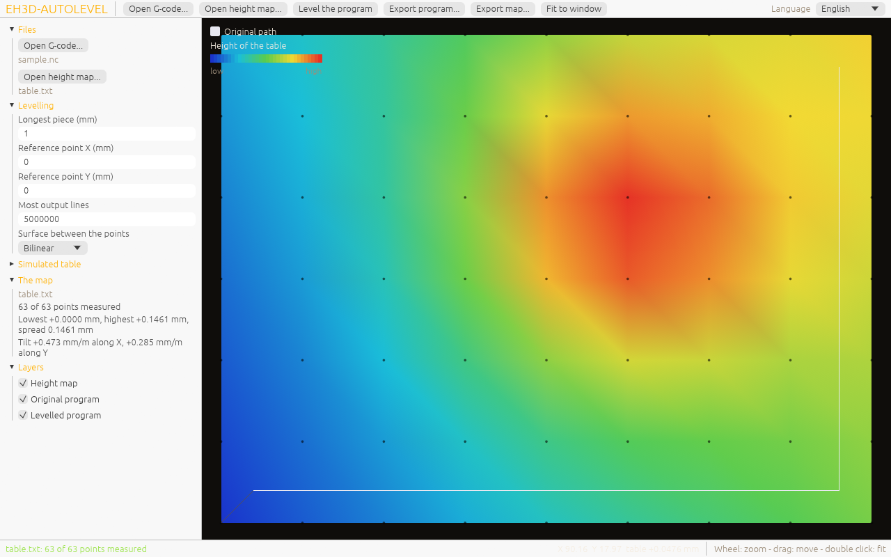

<p align="center">
  
</p>

#  EH3D-AUTOLEVEL
<p align="center"><a href="README.md">🇺🇸 English</a> | 🇪🇸 <b>Español</b> | <a href="README_fra.md">🇫🇷 Français</a> | <a href="README_ita.md">🇮🇹 Italiano</a> | <a href="README_deu.md">🇩🇪 Deutsch</a> | <a href="README_zho.md">🇨🇳 中文</a> | <a href="README_jpn.md">🇯🇵 日本語</a> | <a href="README_por.md">🇵🇹 Português</a></p>

### Corrige la Z de un programa G-code con el mapa de alturas de la mesa

<p align="center">
  
  
  
  
  
</p>

---

**Comprobación de honestidad - lo que funciona hoy:** una biblioteca Rust y un programa de línea de comandos (`eh3d-autolevel`) con 181 pruebas que se ejecutan en un ordenador: corrige la Z de un programa G-code con el mapa de alturas de la mesa, partiendo los movimientos en trozos que siguen la superficie. Tiene una ventana (se compila con `--features gui`) que abre un programa G-code y un mapa de alturas, muestra la mesa como una malla coloreada con las trayectorias niveladas encima y exporta, pero todavía no se ha visto en una pantalla; no se ha probado en una máquina y no se ha comprobado con una colección de ficheros reales.

---

> **Estado de seguridad:** este programa no controla ninguna máquina y no es un sistema de seguridad. Lo que produce debe revisarlo una persona antes de ejecutar nada en una máquina; nada de esto se ha ejecutado en hardware real.


## 📋 De un vistazo

| | |
|---|---|
| Versión | `0.0.7` |
| Madurez | Andamiaje |
| Pruebas | 181 |
| Pila tecnológica | Rust |
| En hardware real | No probado: nada de esto se ha ejecutado en una máquina |

**Ir a:** [Resumen](#-resumen) · [Arquitectura](#-arquitectura) · [Inicio rápido](#-inicio-rápido) · [Pruebas](#-pruebas) · [Estructura](#-estructura-del-repositorio) · [Relacionados](#-proyectos-relacionados)

## 🚦 Estado del proyecto

Cada línea es una parte de este repositorio y la luz dice hasta dónde llega hoy. Se escribe con lo que el repositorio puede demostrar (pruebas, compilaciones, ejecuciones), no con lo previsto.

🟢 Hecho y verificado · 🟡 Funciona, con límites conocidos · 🟠 Hecho a medias o sin verificar · 🔴 Sin hacer o sin funcionar

| Área | Estado | Qué significa aquí |
|---|---|---|
| Núcleo | 🟡 | corrige la Z de un programa G-code con el mapa de alturas de la mesa, partiendo los movimientos en trozos que siguen la superficie; probado en un ordenador con entradas normales y dañadas, no con una colección de ficheros reales. |
| Línea de comandos | 🟡 | `eh3d-autolevel` ejecuta las mismas funciones que la biblioteca e imprime el resultado; cada error vuelve como mensaje y un código de salida distinto de cero. |
| Pruebas | 🟡 | 181 pruebas pasan (`cargo test`), con casos normales, casos límite y entradas dañadas. |
| Seguridad | 🟡 | Rust seguro y simple (`forbid(unsafe_code)`): nada entra en pánico con los ficheros recibidos y un valor malo es un error con su motivo; sin revisión independiente. |
| Ventana | 🟠 | Escrita (egui, `--features gui`): abrir o soltar un programa y un mapa de alturas, simular una mesa, ver la mesa como malla coloreada y las trayectorias niveladas, zoom y desplazamiento, ajustar la nivelación, exportar; su lógica está probada, pero todavía no se ha compilado ni visto en una pantalla. |
| Hardware real | 🔴 | No probado: nada de esto se ha ejecutado en una máquina. |
| Documentación | 🟡 | README en ocho idiomas, el registro de cambios y las dos imágenes dibujadas desde `docs/`. |

## 🎯 Resumen

* **El programa** (`src/gcode.rs`): un movimiento de corte (G1) se parte en trozos no más largos que la longitud elegida y cada trozo recibe la Z que da el mapa para su final; un movimiento rápido (G0) solo se corrige si lleva Z. El cero de la corrección es un punto de referencia, donde se fijó la Z del trabajo.
* **La superficie** (`src/surface.rs`): bilineal (la del mapa de EH3D-COMMON) o bicúbica (Catmull-Rom), que pasa por todos los puntos medidos y sigue mejor una mesa curva; fuera de la malla se usa la altura del borde más cercano.
* **Lo que se rechaza** con el número de línea: distancias relativas (G91), pulgadas (G20), arcos (G2, G3), un movimiento antes de cualquier G0 o G1, un número que no lo es, una coordenada más allá de un millón de milímetros, un movimiento que daría más de cien mil trozos y un mapa con puntos sin medir.
* **Línea de comandos estricta:** una opción mal escrita (`--powr`) o una palabra de más es un error que la nombra, no algo que se ignora; si no, el programa haría su salida con los valores por defecto.
* **Nunca nivelado dos veces:** el programa corregido empieza con una línea de comentario (`(eh3d-autolevel VERSION map=HASH ref=X,Y método seg=N)`) que dice que ya se niveló y con qué mapa; un programa que la lleva se rechaza con su línea, porque corregirlo otra vez sumaría dos veces la corrección de la mesa.
* **Se rechazan los códigos que mueven el origen:** G10, G28, G30, G38, G43, G53, G92 y cualquier otro código G que no sea un movimiento simple ni un ajuste que deje la posición como está detienen el programa con el número de línea (antes se convertían en movimientos a Z0); una espera (G4) y la línea `%` del principio y del final de un programa pasan sin cambios, y un mapa que no da una altura finita se rechaza en vez de escribir `Z NaN`.
* **`--dry-run`:** `apply` calcula el resultado y lo cuenta (movimientos, trozos añadidos, desplazamiento de Z) sin escribir el fichero de salida, que entonces puede omitirse.

## 🧩 Papel en EH3D

EH3D-AUTOLEVEL es un programa de la EH3D Fabrication Suite. Funciona como biblioteca y línea de comandos y, compilado con `--features gui`, como ventana con el aspecto que comparten los demás programas de la suite. Lee y escribe ficheros simples, así que puede usarse solo o entre los demás programas.

## 🏛️ Arquitectura

<p align="center">
  
</p>


Cómo encajan las partes de este repositorio: quién lo usa, qué contiene y de qué depende. La imagen se dibuja desde `docs/architecture.json` y se comprueba con el código.

## 🖼️ Capturas de pantalla

<p align="center">
  
</p>

<p align="center"><em>La ventana con un programa y un mapa de alturas de ejemplo: la mesa coloreada de baja a alta, los puntos medidos y la trayectoria del programa, con el resumen del mapa a la izquierda.</em></p>

## ✨ Funciones

* **Biblioteca y línea de comandos:** cada orden de `eh3d-autolevel` es una función de la biblioteca, así que otro programa de la suite puede llamarla sin lanzar un proceso.
* **Pruebas con entradas dañadas:** las pruebas también dan ficheros vacíos, basura, números enormes y ficheros cortados, y ninguna puede provocar un pánico.
* **Sin adivinar:** un valor que no tiene sentido es un error que dice cuál y por qué, nunca un resultado que solo lo parece.
* **Sin código unsafe:** `#![forbid(unsafe_code)]` en la biblioteca y el programa.
* **Las líneas que no son movimientos pasan tal cual:** los comandos `$`, las asignaciones `#` y los mensajes `M117` y `M118` se escriben como están, la suma de comprobación de una línea numerada no es una palabra, las palabras `M` de un movimiento cortado van con su última pieza y `--max-lines` (5000000 por defecto) rechaza un programa con más líneas de salida.
* **Los ejes rotativos A, B y C se interpolan:** cuando un movimiento de corte se parte en piezas, sus palabras `A`, `B` y `C` van en línea recta del valor que tenían al que da el movimiento (son modales y empiezan en 0), con los mismos decimales que X, Y y Z, y la última pieza acaba exactamente en el destino; la Z de la mesa sigue saliendo solo de X e Y. Un programa sin palabras rotativas se escribe como antes.
* **Compensación de Z por el giro del eje A:** con `a-axis-compensation = tilt` y `a-axis-radius-mm = r` (o `--a-compensation tilt --a-radius r`), a la Z de cada movimiento escrito se le suma `r * (1 - cos A)` después de la altura de la mesa, con A en grados tal como la deja el movimiento (interpolada pieza a pieza); por defecto es `off`, que no cambia ninguna salida, y un aviso por la salida de errores dice cuándo se aplicó. La fórmula está en `docs/a-axis-compensation.md`.
* **Los ejes B y C:** el eje B (un giro sobre Y) tiene la misma compensación con su propio radio (`b-axis-compensation = tilt` y `b-axis-radius-mm` en el fichero, `--b-compensation` y `--b-radius`) y las dos se suman; el eje C gira sobre Z, no cambia ninguna altura y no necesita ninguna (sus palabras se llevan e interpolan como las de A y B). Una máquina simulada recorre el programa nivelado y comprueba la profundidad bajo la mesa; nada se ha ejecutado en una máquina con ejes rotativos.
* **El programa nivelado empieza con la cabecera estándar:** el generador y su versión, las unidades, el programa de origen con su SHA-256 y las herramientas, como líneas de comentario antes de la marca; las pruebas vuelven a leer el resultado con el lector de la suite y no encuentran ningún aviso, ningún movimiento rápido dentro del material ni ningún corte con el husillo parado.

## 🔒 Seguridad y protección

| Amenaza | Defensa |
|---|---|
| Un fichero dañado, cortado o vacío | sin pánico: las pruebas cortan una entrada válida en cada posición y dan basura |
| Un número sin sentido (negativo, no finito, absurdamente grande) | se rechaza con un error que nombra el valor; nada se redondea hasta parecer plausible |
| Uso inseguro de memoria | Rust seguro y simple con `forbid(unsafe_code)` |

**Lo que no se defiende:** un resultado producido sin errores no es un resultado verificado. Nada de esto conoce los límites de una máquina y el programa no ha tenido revisión independiente. Informe de una vulnerabilidad en privado (véase [SECURITY.md](SECURITY.md)).

## 🔌 Interfaces

La biblioteca es `eh3d_autolevel` (`use eh3d_autolevel::...`); la línea de comandos es `eh3d-autolevel`. Las órdenes son estas; cada una imprime su resultado por la salida estándar e informa de un error por la salida de errores con un código de salida distinto de cero. No hay acceso a la red.

```text
eh3d-autolevel apply MAP.txt IN.nc OUT.nc [--segment 1.0] [--ref X,Y] [--bicubic] [--max-lines 5000000] [--decimals 3] [--warn-shift MM] [--a-compensation off|tilt] [--a-radius MM] [--config FILE] [--dry-run]
eh3d-autolevel config                            every setting with its default, as a file
eh3d-autolevel info MAP.txt                      how many points, the spread and the tilt of the table
eh3d-autolevel demo-map OUT.txt X0 Y0 X1 Y1 COLS ROWS    a map of a simulated tilted table with a bump
eh3d-autolevel [gui] [FILE...]                   the window (a build with --features gui); with no arguments it opens
```

## ⚙️ Configuración

Un pequeño fichero de ajustes (`clave = valor`, uno por línea, `#` empieza un comentario) guarda lo que merece afinarse; hoy tiene cinco claves: `decimals`, cuántos decimales se escriben en X, Y y Z del programa nivelado (3 por defecto, de 1 a 6), y `max-lines`, el máximo de líneas que puede tener el programa nivelado (5000000 por defecto, de 1 a 100000000). `eh3d-autolevel config` imprime el fichero con cada valor por defecto (`examples/autolevel.cfg` es ese fichero), `--config FICHERO` lee uno y `--decimals N` y `--max-lines N` dan las mismas claves en la línea de comandos y ganan al fichero. Un valor sin sentido es un error que dice su línea. Lo demás se da como argumentos de la línea de comandos (véase Interfaces) y cada valor por defecto está escrito en la ayuda de la orden (`eh3d-autolevel help`). Los límites fijos están en el código como constantes con nombre y las pruebas los cubren. `warn-shift-mm` es la corrección de Z, en mm, a partir de la cual `apply` muestra un aviso por la salida de errores (0 por defecto: sin aviso; de 0,001 a 100); `--warn-shift MM` la da en la línea de órdenes y gana al fichero, y el programa corregido se escribe igualmente. `a-axis-compensation` (`off` o `tilt`, por defecto `off`; `--a-compensation`) y `a-axis-radius-mm` (la distancia en mm del eje A al corte, de -1000 a 1000 y distinta de 0 con `tilt`; `--a-radius`) suman a Z la corrección que trae el giro del eje A (véase `docs/a-axis-compensation.md`); las opciones ganan al fichero.

## 🚀 Inicio rápido

Necesita una cadena de herramientas Rust estable (1.88 o más reciente).

```bash
cargo build --release
cargo test
cargo run --release -- info examples/table.txt
cargo run --release --features gui   # the window
cargo run --release --features gui -- --shot screen.png examples/sample.nc   # a picture of the window
```

Para sacar una captura de la ventana sin abrirla a mano, ejecútelo con `--shot FICHERO.png` (también `--size WxH`, `--theme forge|dark|light`, `--wait N`, `--lang CODE`, `--open FILE`, `--replace`): se abre con ese tamaño, guarda el PNG, no guarda ajustes y se cierra solo (código de salida 0 si se escribió el fichero, 1 si no, 2 si los argumentos están mal).

## 🧪 Pruebas

El conjunto tiene 181 pruebas (`cargo test`, ejecutadas en Windows y Linux en el CI). Comprueban los casos normales, los casos límite y las entradas dañadas: ficheros vacíos, basura y ficheros cortados nunca provocan un pánico. El CI ejecuta además `cargo fmt --check`, `cargo clippy` con las advertencias como errores y `python -I tools/ci_validate.py`.

## 🏗️ Compilación y publicación

La versión está en `Cargo.toml` y en `eh3d.project.json`; cada versión tiene su entrada en [CHANGELOG.md](CHANGELOG.md). `build.bat` / `build.sh` compilan el programa, `test.bat` / `test.sh` ejecutan las pruebas y `run.bat` / `run.sh` lo ejecutan con un ejemplo. Las versiones se publican en GitHub.

### Descargas

Cada versión trae el programa con su ventana para Windows (64 y 32 bits), Linux (64 bits) y macOS (Apple silicon e Intel), como `<nombre>-<versión>-<sistema>.zip` (Windows) o `.tar.gz` con el programa, la licencia, el léame, el icono y los ejemplos. Los ficheros los construye GitHub Actions, van en `SHA256SUMS` y están firmados con la clave de EH3D. Para comprobar una descarga, compara su hash con el fichero `.sha256` que la acompaña (`sha256sum -c`) y comprueba su firma con el fichero `.sig` que la acompaña (`ssh-keygen -Y verify`).

## 📂 Estructura del repositorio

<p align="center">
  
</p>

<details>
<summary>Versión en texto del árbol</summary>

```text
EH3D-AUTOLEVEL/
├── src/
│   ├── lib.rs                                   la biblioteca: lo que usa cada orden
│   ├── main.rs                                  la línea de comandos
│   ├── cli_args.rs                              los argumentos de la línea de comandos, el mismo fichero en cada utilidad pequeña
│   ├── config.rs                                el fichero de ajustes: los decimales de las coordenadas y el límite de líneas del programa nivelado
│   ├── gcode.rs                                 una parte de la lógica
│   ├── surface.rs                               una parte de la lógica
│   ├── browse.rs                                la lista de ficheros de la ventana que abre un fichero
│   ├── gui.rs                                   la ventana (egui, con la característica gui): dibuja el estado y transmite lo que hace la persona
│   ├── lang.rs                                  las palabras de la ventana en los ocho idiomas
│   ├── shot.rs                                  el modo de captura de la ventana (--shot): sus argumentos, leídos y comprobados sin pantalla
│   ├── viewport.rs                              zoom y desplazamiento de la imagen, en números simples
│   └── window.rs                                el estado de la ventana sin pantalla: programa, mapa, ajustes y exportación
├── tests/
│   ├── a_axis.rs                                tests de la corrección de Z por el giro del eje A, de sus claves de ajustes y de sus opciones
│   ├── rotary_axes.rs                           pruebas de los ejes B y C y de la máquina simulada que comprueba la profundidad bajo la mesa
│   ├── autolevel.rs                             pruebas de la biblioteca y la línea de comandos
│   ├── decimals.rs                              tests de los decimales de las coordenadas y del fichero de ajustes
│   ├── dry_run.rs                               pruebas de --dry-run: cuenta lo mismo y no escribe nada
│   ├── rotary.rs                                tests de la interpolación de A, B y C y del límite de líneas del fichero de ajustes
│   ├── readme.rs                                pruebas que ejecutan lo que prometen el README y los scripts run
│   ├── strict.rs                                pruebas de la marca de un programa nivelado y de la línea de comandos estricta
│   ├── window_cli.rs                            pruebas de que una compilación sin la característica gui sigue siendo solo línea de comandos
│   └── warn_shift.rs                            tests del aviso por una corrección de Z superior a un límite y de su clave de ajustes
├── examples/
│   ├── autolevel.cfg                            el fichero de ajustes con cada ajuste y su valor por defecto
│   ├── sample.nc                                una muestra para probar el programa
│   └── table.txt                                una muestra para probar el programa
├── docs/
│   ├── a-axis-compensation.md                   la fórmula de la corrección de Z por el giro del eje A, con valores calculados
│   ├── architecture.json                        datos de la imagen de Arquitectura
│   └── structure.json                           datos de la imagen de Estructura
├── tools/                                       comprobación del CI y del README y herramientas de imágenes
├── images/                                      banner y las imágenes de Arquitectura y Estructura del repositorio
├── .github/                                     flujos de CI y de publicación, plantillas de issues y pull requests
├── eh3d.project.json                            manifiesto: versión, rol, madurez y comando de compilación
├── Cargo.toml Cargo.lock                        el workspace y sus dependencias fijadas
├── rust-toolchain.toml                          la toolchain de Rust fijada
├── CHANGELOG.md                                 qué cambió en cada versión
├── SECURITY.md SUPPORT.md                       cómo informar de una vulnerabilidad y dónde preguntar
└── CONTRIBUTING.md CODE_OF_CONDUCT.md LICENSE   cómo contribuir, el código de conducta y la licencia
```

</details>

## 🗺️ Hoja de ruta y límites conocidos

**Límites conocidos hoy**

* La ventana todavía no se ha visto en una pantalla y no puede medir una mesa: el mapa se abre de un fichero o se simula.
* No se ha probado en una máquina ni con una colección de ficheros reales y no ha tenido revisión independiente.
* Los arcos se rechazan en vez de partirse en trozos, se supone que el programa empieza en X0 Y0 Z0 y el mapa viene de la sonda de la suite o de una mesa simulada, no de una medida real.

**Siguiente**

* Partir los arcos en trozos, tomar la posición inicial de la máquina y corregir el programa mientras se envía, no antes.
* Ver la ventana en una pantalla y terminarla.
* Probarlo con ficheros reales y con los demás programas de la suite.

## 🌍 Idiomas

El README y los textos existen en inglés, español, francés, italiano, alemán, chino, japonés y portugués de Portugal.

## 🔗 Proyectos relacionados

* [EH3D-COMMON](https://github.com/JuanenRac/EH3D-COMMON): el contenedor de proyecto y los tipos compartidos de la suite
* [EH3D-PHOENIX-CNC](https://github.com/JuanenRac/EH3D-PHOENIX-CNC): el programa de control de máquina
* [EH3D-ISOCAM](https://github.com/JuanenRac/EH3D-ISOCAM): el fresado de aislamiento del cobre
* [EH3D-ROUTEPRO](https://github.com/JuanenRac/EH3D-ROUTEPRO): el programa de fresado de contorno
* [EH3D-CAM-DEBUGGER](https://github.com/JuanenRac/EH3D-CAM-DEBUGGER): la revisión del G-code antes de llegar a una máquina

## 📚 Documentación

* [Registro de cambios](CHANGELOG.md)
* [Datos de arquitectura y estructura](docs/architecture.json): los datos con los que se dibujan las dos imágenes.

## 🤝 Contribuir y comunidad

* Antes de una pull request ejecute `cargo fmt --check`, `cargo clippy --all-targets -- -D warnings`, `cargo test` y `python -I tools/ci_validate.py`: todo debe pasar. Véanse [CONTRIBUTING.md](CONTRIBUTING.md) y el [código de conducta](CODE_OF_CONDUCT.md).
* El README existe en ocho idiomas: un cambio de texto se hace en los ocho ficheros, y las dos imágenes se dibujan desde `docs/architecture.json` y `docs/structure.json` con `tools/make_architecture.py` y `tools/make_structure.py`.
* Informe de una vulnerabilidad en privado: [SECURITY.md](SECURITY.md). Preguntas, ideas e informes: electrohobby3d@gmail.com ([SUPPORT.md](SUPPORT.md)).

## 👤 AUTOR

**JuanenRac (Electro Hobby 3D)** · electrohobby3d@gmail.com

## 📜 LICENCIA

Software: GPL-3.0-or-later. Véase [LICENSE](LICENSE). Los diseños de hardware de la suite usan CERN OHL-S.
