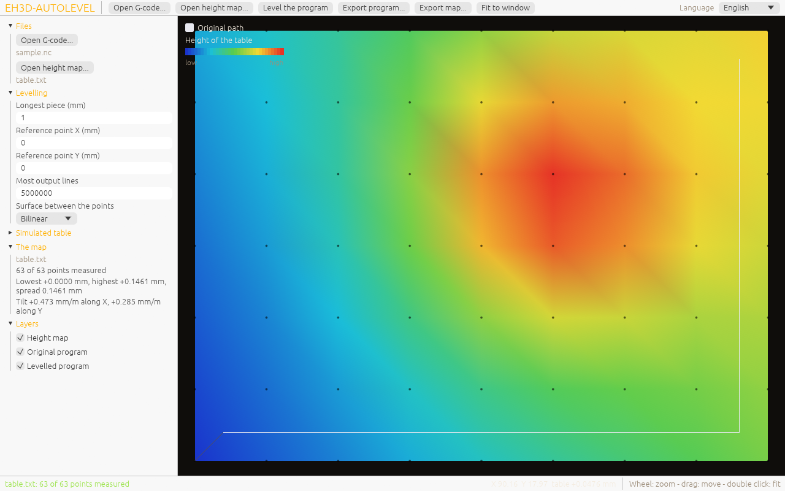

<p align="center">
  
</p>

#  EH3D-AUTOLEVEL
<p align="center"><a href="README.md">🇺🇸 English</a> | <a href="README_spa.md">🇪🇸 Español</a> | <a href="README_fra.md">🇫🇷 Français</a> | <a href="README_ita.md">🇮🇹 Italiano</a> | <a href="README_deu.md">🇩🇪 Deutsch</a> | 🇨🇳 <b>中文</b> | <a href="README_jpn.md">🇯🇵 日本語</a> | <a href="README_por.md">🇵🇹 Português</a></p>

### 用工作台高度图修正 G 代码程序的 Z 值

<p align="center">
  
  
  
  
  
</p>

---

**诚实检查 - 当前真正能运行的内容：** 一个 Rust 库和一个命令行程序（`eh3d-autolevel`），有 185 个在电脑上运行的测试：用工作台高度图修正 G 代码程序的 Z 值，并把移动切成沿表面的小段。有一个窗口（用 `--features gui` 构建），可以打开 G 代码程序和高度图，把工作台显示为彩色网格并在其上叠加校平后的路径，还能导出，但窗口尚未在屏幕上看过，没有在机器上试过，也没有用大量真实文件验证过。

---

> **安全状态：** 本程序不控制任何机器，也不是安全系统。它的输出在机器上运行之前必须由人检查；这里的任何内容都没有在真实硬件上运行过。


## 📋 速览

| | |
|---|---|
| 版本 | `0.0.8` |
| 成熟度 | 脚手架 |
| 测试 | 185 |
| 技术栈 | Rust |
| 真实硬件 | 未试过：这里的任何内容都没有在机器上运行过 |

**跳转到：** [概述](#-概述) · [架构](#-架构) · [快速开始](#-快速开始) · [测试](#-测试) · [结构](#-仓库结构) · [相关项目](#-相关项目)

## 🚦 项目状态

每一行是本仓库的一个部分，灯号表示它今天做到了哪一步。内容依据仓库能够展示的证据（测试、构建、运行），而不是计划。

🟢 已完成并验证 · 🟡 可用，有已知限制 · 🟠 部分完成或尚未验证 · 🔴 未完成或不可用

| 领域 | 状态 | 在这里的含义 |
|---|---|---|
| 核心 | 🟡 | 用工作台高度图修正 G 代码程序的 Z 值，并把移动切成沿表面的小段；已在电脑上用正常和损坏的输入测试，未用大量真实文件验证。 |
| 命令行 | 🟡 | `eh3d-autolevel` 运行与库相同的函数并打印结果；每个错误都以消息和非零退出码返回。 |
| 测试 | 🟡 | 185 个测试通过（`cargo test`），包含正常情况、边界情况和损坏的输入。 |
| 安全 | 🟡 | 纯安全 Rust（`forbid(unsafe_code)`）：处理收到的文件时不会 panic，错误的值会返回带原因的错误；没有独立审查。 |
| 窗口 | 🟠 | 已编写（egui，`--features gui`）：打开或拖入程序和高度图、模拟工作台、以彩色网格查看工作台和校平后的路径、缩放和平移、设置校平参数、导出；其逻辑已测试，但尚未构建，也尚未在屏幕上看过。 |
| 真实硬件 | 🔴 | 未试过：这里的任何内容都没有在机器上运行过。 |
| 文档 | 🟡 | 八种语言的 README、更新日志，以及由 `docs/` 绘制的两张图。 |

## 🎯 概述

* **程序**（`src/gcode.rs`）：切削移动（G1）被切成不超过所选长度的小段，每段的终点由高度图给出 Z；快速移动（G0）只有带 Z 时才修正。修正的零点是一个参考点，即设定作业 Z 的位置。
* **表面**（`src/surface.rs`）：双线性（EH3D-COMMON 中高度图自带的）或双三次（Catmull-Rom），后者经过每个测量点，更贴合弯曲的工作台；网格之外使用最近边缘的高度。
* **会被拒绝的内容**（带行号）：相对坐标（G91）、英寸（G20）、圆弧（G2、G3）、出现在任何 G0 或 G1 之前的移动、不是数字的数字、超过一百万毫米的坐标、会产生十万段以上的移动，以及含有未测量点的高度图。
* **严格的命令行：** 写错的选项（`--powr`）或多余的词会产生指明它的错误，而不是被忽略；否则程序会用默认值生成输出。
* **绝不调平两次：** 修正后的程序以一行注释（`(eh3d-autolevel VERSION map=HASH ref=X,Y 方法 seg=N)`）开头，说明它已被调平以及用的是哪张地图；带有这一行的程序会连同行号被拒绝，因为再次修正会把工作台的修正加两遍。
* **会移动原点的代码会被拒绝：** G10、G28、G30、G38、G43、G53、G92 以及任何既不是普通移动、也不是不改变位置的设置的 G 代码，都会连同行号一起中止程序（以前它们会被变成移动到 Z0）；暂停（G4）以及程序开头和结尾的 `%` 行原样通过，而没有有限高度的地图会被拒绝，不会写出 `Z NaN`。
* **`--dry-run`：** `apply` 计算结果并统计（移动数、新增分段、Z 偏移），但不写入输出文件（此时可省略该文件）。

## 🧩 在 EH3D 中的角色

EH3D-AUTOLEVEL 是 EH3D Fabrication Suite 的一个程序。它以库和命令行的形式工作，用 `--features gui` 构建时还是一个与套件其他程序外观一致的窗口。它读写简单的文件，因此可以单独使用，也可以用在其他程序之间。

## 🏛️ 架构

<p align="center">
  
</p>


本仓库各部分如何配合：谁使用它、它包含什么、它依赖什么。图由 `docs/architecture.json` 绘制并与代码核对。

## 🖼️ 屏幕截图

<p align="center">
  
</p>

<p align="center"><em>载入示例程序和高度图的窗口：工作台按高低着色，显示测量点和程序路径，左侧为高度图的摘要。</em></p>

## ✨ 功能

* **库加命令行：** `eh3d-autolevel` 的每个命令都是库中的函数，套件中的其他程序无需启动进程即可调用。
* **损坏输入的测试：** 测试还会输入空文件、乱码、巨大数字和被截断的文件，任何情况都不允许 panic。
* **不猜测：** 没有意义的值是一个说明哪个值、为什么的错误，绝不是只是看起来正确的结果。
* **没有 unsafe 代码：** 库和程序中都有 `#![forbid(unsafe_code)]`。
* **不是移动的行原样通过：** `$` 命令、`#` 赋值以及消息 `M117` 和 `M118` 原样写出，带行号的校验和不算一个字，被切分的移动的 `M` 字跟随最后一段，`--max-lines`（默认 5000000）拒绝输出行数更多的程序。
* **旋转轴 A、B、C 会被插值：** 切削移动被切成若干段时，其 `A`、`B`、`C` 字从原来的值沿直线变到移动给出的值（它们是模态的，初始为 0），小数位数与 X、Y、Z 相同；最后一段恰好落在目标值上，工作台的 Z 仍然只由 X 和 Y 得出。没有旋转轴字的程序与以前写法完全相同。
* **A 轴转动的 Z 补偿：** 使用 `a-axis-compensation = tilt` 和 `a-axis-radius-mm = r`（或 `--a-compensation tilt --a-radius r`）时，每条写出的移动的 Z 在工作台高度之后再加上 `r * (1 - cos A)`，A 以度为单位，取移动结束时的值（逐段插值）；默认为 `off`，不会改变任何输出，应用时会在错误输出上给出提示。公式见 `docs/a-axis-compensation.md`。
* **B 轴和 C 轴：** B 轴（绕 Y 轴旋转）有与 A 轴相同的补偿，并有自己的半径（文件中为 `b-axis-compensation = tilt` 和 `b-axis-radius-mm`，命令行为 `--b-compensation` 和 `--b-radius`），两者相加；C 轴绕 Z 轴旋转，不改变高度，因此不需要补偿（其字与 A、B 一样被保留并插值）。模拟机床会遍历校平后的程序并检查工作台下的深度；尚未在带旋转轴的机床上运行过。
* **校平后的程序以标准文件头开头:** 生成程序及其版本、单位、来源程序及其 SHA-256 和刀具,作为标记之前的注释行;测试用套件的读取器重新读取结果,找不到任何警告、进入材料的快速移动或主轴停转时的切削。

## 🔒 安全与防护

| 威胁 | 防御 |
|---|---|
| 损坏、被截断或为空的文件 | 不会 panic：测试在每个位置截断有效输入并输入乱码 |
| 没有意义的数字（负数、非有限值、过大的数） | 以指出该值的错误拒绝；不会被舍入成看似合理的值 |
| 不安全的内存使用 | 带 `forbid(unsafe_code)` 的纯安全 Rust |

**没有防御的内容：** 无错误产生的结果不等于经过验证的结果。这里没有任何内容了解机器的极限，程序也没有经过独立审查。请私下报告漏洞（见 [SECURITY.md](SECURITY.md)）。

## 🔌 接口

库为 `eh3d_autolevel`（`use eh3d_autolevel::...`），命令行为 `eh3d-autolevel`。命令如下；每个命令把结果打印到标准输出，把错误以非零退出码报告到标准错误。没有网络访问。

```text
eh3d-autolevel apply MAP.txt IN.nc OUT.nc [--segment 1.0] [--ref X,Y] [--bicubic] [--max-lines 5000000] [--decimals 3] [--warn-shift MM] [--a-compensation off|tilt] [--a-radius MM] [--config FILE] [--dry-run]
eh3d-autolevel config                            every setting with its default, as a file
eh3d-autolevel info MAP.txt                      how many points, the spread and the tilt of the table
eh3d-autolevel demo-map OUT.txt X0 Y0 X1 Y1 COLS ROWS    a map of a simulated tilted table with a bump
eh3d-autolevel [gui] [FILE...]                   the window (a build with --features gui); with no arguments it opens
```

## ⚙️ 配置

一个小的设置文件（`键 = 值`，每行一个，`#` 开始注释）保存值得调整的内容；目前有五个键：`decimals`，校平后程序中 X、Y、Z 写成几位小数（默认 3，范围 1 到 6）；`max-lines`，校平后程序最多有多少行（默认 5000000，范围 1 到 100000000）。`eh3d-autolevel config` 会打印带有所有默认值的文件（`examples/autolevel.cfg` 就是该文件），`--config FILE` 读取文件，`--decimals N` 和 `--max-lines N` 在命令行给出同样的键并优先于文件。无意义的值会报错并指出其行号。其余内容通过命令行参数给出（见接口），每个默认值都写在命令的帮助中（`eh3d-autolevel help`）。固定的限制是代码中的具名常量，并有测试覆盖。 `warn-shift-mm` 是 Z 修正量（毫米）的上限，超过时 `apply` 会在错误输出上显示警告（默认 0：不警告；范围 0.001 到 100）；命令行的 `--warn-shift MM` 优先于文件，修正后的程序照常写出。`a-axis-compensation`（`off` 或 `tilt`，默认 `off`，选项 `--a-compensation`）和 `a-axis-radius-mm`（A 轴到切削点的距离，单位毫米，范围 -1000 到 1000，`tilt` 时不能为 0，选项 `--a-radius`）会把 A 轴转动带来的修正量加到 Z 上（见 `docs/a-axis-compensation.md`）；选项优先于文件。

## 🚀 快速开始

需要稳定版 Rust 工具链（1.88 或更新）。

```bash
cargo build --release
cargo test
cargo run --release -- info examples/table.txt
cargo run --release --features gui   # the window
cargo run --release --features gui -- --shot screen.png examples/sample.nc   # a picture of the window
```

要在不手动打开窗口的情况下截取窗口图像，请使用 `--shot FILE.png` 运行（还可用 `--size WxH`, `--theme forge|dark|light`, `--wait N`, `--lang CODE`, `--open FILE`, `--replace`）：它按该尺寸打开，保存 PNG，不保留任何设置并自动关闭（写入文件成功时退出码为 0，否则为 1，参数错误时为 2）。

## 🧪 测试

测试套件有 185 个测试（`cargo test`，CI 在 Windows 和 Linux 上运行）。它们检查正常情况、边界情况和损坏的输入：空文件、乱码和被截断的文件绝不会 panic。CI 还运行 `cargo fmt --check`、把警告当作错误的 `cargo clippy` 以及 `python -I tools/ci_validate.py`。

## 🏗️ 构建与发布

版本号位于 `Cargo.toml` 和 `eh3d.project.json`；每个版本在 [CHANGELOG.md](CHANGELOG.md) 中都有条目。`build.bat` / `build.sh` 构建程序，`test.bat` / `test.sh` 运行测试，`run.bat` / `run.sh` 用示例运行。版本发布在 GitHub 上。

### 下载

每个版本都提供带窗口的程序，适用于 Windows（64 位和 32 位）、Linux（64 位）和 macOS（Apple silicon 和 Intel），文件名为 `<名称>-<版本>-<系统>.zip`（Windows）或 `.tar.gz`，内含程序、许可证、自述文件、图标和示例。这些文件由 GitHub Actions 构建，列在 `SHA256SUMS` 中，并使用 EH3D 的密钥签名。要检查下载的文件，请将其哈希与旁边的 `.sha256` 文件比较（`sha256sum -c`），并用旁边的 `.sig` 文件检查签名（`ssh-keygen -Y verify`）。

## 📂 仓库结构

<p align="center">
  
</p>

<details>
<summary>目录树的文本版</summary>

```text
EH3D-AUTOLEVEL/
├── src/
│   ├── lib.rs                                   库：每个命令所使用的部分
│   ├── main.rs                                  命令行
│   ├── cli_args.rs                              命令行参数：每个小工具中的同一个文件
│   ├── config.rs                                设置文件：校平后程序坐标的小数位数和行数上限
│   ├── gcode.rs                                 逻辑的一部分
│   ├── surface.rs                               逻辑的一部分
│   ├── browse.rs                                打开文件窗口的文件列表
│   ├── gui.rs                                   窗口（egui，gui 特性）：绘制状态并传递用户的操作
│   ├── lang.rs                                  窗口的文字（八种语言）
│   ├── shot.rs                                  窗口的截图模式（--shot）：无需屏幕即可读取和检查其参数
│   ├── viewport.rs                              图像的缩放和平移（纯数值）
│   └── window.rs                                不需要屏幕的窗口状态：程序、高度图、设置和导出
├── tests/
│   ├── fuzz.rs                                  固定种子的测试：损坏的文件、截断和异常数字
│   ├── a_axis.rs                                A 轴转动的 Z 补偿及其设置键和选项的测试
│   ├── rotary_axes.rs                           B 轴和 C 轴以及检查工作台下深度的模拟机床的测试
│   ├── autolevel.rs                             库和命令行的测试
│   ├── decimals.rs                              坐标小数位数和设置文件的测试
│   ├── dry_run.rs                               --dry-run 测试：计数相同且不写入任何内容
│   ├── rotary.rs                                A、B、C 插值和设置文件行数上限的测试
│   ├── readme.rs                                运行 README 和 run 脚本所承诺内容的测试
│   ├── strict.rs                                已调平程序的标记和严格命令行的测试
│   ├── window_cli.rs                            测试没有 gui 特性的构建仍然只是命令行
│   └── warn_shift.rs                            Z 修正量超过上限时的警告及其设置键的测试
├── examples/
│   ├── autolevel.cfg                            列出每项设置及其默认值的设置文件
│   ├── sample.nc                                试用的示例
│   └── table.txt                                试用的示例
├── docs/
│   ├── a-axis-compensation.md                   A 轴转动的 Z 补偿公式及计算示例
│   ├── architecture.json                        架构图数据
│   └── structure.json                           结构图数据
├── tools/                                       CI 和 README 检查及绘图工具
├── images/                                      横幅图以及架构和仓库结构图片
├── .github/                                     CI 与发布工作流、Issue 和 PR 模板
├── eh3d.project.json                            清单：版本、角色、成熟度和构建命令
├── Cargo.toml Cargo.lock                        工作区及其锁定的依赖
├── rust-toolchain.toml                          固定的 Rust 工具链
├── CHANGELOG.md                                 每个版本的变更
├── SECURITY.md SUPPORT.md                       如何报告漏洞及在哪里提问
└── CONTRIBUTING.md CODE_OF_CONDUCT.md LICENSE   参与贡献、行为准则和许可证
```

</details>

## 🗺️ 路线图与已知限制

**目前已知的限制**

* 窗口尚未在屏幕上看过，也不能测量工作台：高度图从文件打开或模拟。
* 没有在机器上试过，也没有用大量真实文件验证过，也没有独立审查。
* 圆弧会被拒绝而不是切成小段，程序被假定从 X0 Y0 Z0 开始，高度图来自套件的探针或模拟工作台，而不是真实测量。

**下一步**

* 把圆弧切成小段，从机器取得起始位置，并在发送过程中而不是事先修正程序。
* 在屏幕上查看窗口并完善它。
* 用真实文件和套件的其他程序进行试用。

## 🌍 语言

README 和文本提供英语、西班牙语、法语、意大利语、德语、汉语、日语和欧洲葡萄牙语版本。

## 🔗 相关项目

* [EH3D-COMMON](https://github.com/JuanenRac/EH3D-COMMON): 项目容器和套件共用类型
* [EH3D-PHOENIX-CNC](https://github.com/JuanenRac/EH3D-PHOENIX-CNC): 机器控制程序
* [EH3D-ISOCAM](https://github.com/JuanenRac/EH3D-ISOCAM): 铜箔隔离铣削
* [EH3D-ROUTEPRO](https://github.com/JuanenRac/EH3D-ROUTEPRO): 轮廓铣削程序
* [EH3D-CAM-DEBUGGER](https://github.com/JuanenRac/EH3D-CAM-DEBUGGER): G 代码到达机器之前的检查

## 📚 文档

* [更新日志](CHANGELOG.md)
* [架构与结构数据](docs/architecture.json)：绘制两张图所用的数据。

## 🤝 参与贡献与社区

* 提交拉取请求前请运行 `cargo fmt --check`、`cargo clippy --all-targets -- -D warnings`、`cargo test` 和 `python -I tools/ci_validate.py`：必须全部通过。见 [CONTRIBUTING.md](CONTRIBUTING.md) 和[行为准则](CODE_OF_CONDUCT.md)。
* README 有八种语言：修改文字要在八个文件中同时进行，两张图由 `tools/make_architecture.py` 和 `tools/make_structure.py` 根据 `docs/architecture.json` 和 `docs/structure.json` 绘制。
* 请私下报告漏洞：[SECURITY.md](SECURITY.md)。问题、想法和报告：electrohobby3d@gmail.com（[SUPPORT.md](SUPPORT.md)）。

## 👤 作者

**JuanenRac (Electro Hobby 3D)** · electrohobby3d@gmail.com

## 📜 许可证

软件：GPL-3.0-or-later。见 [LICENSE](LICENSE)。套件的硬件设计使用 CERN OHL-S。
